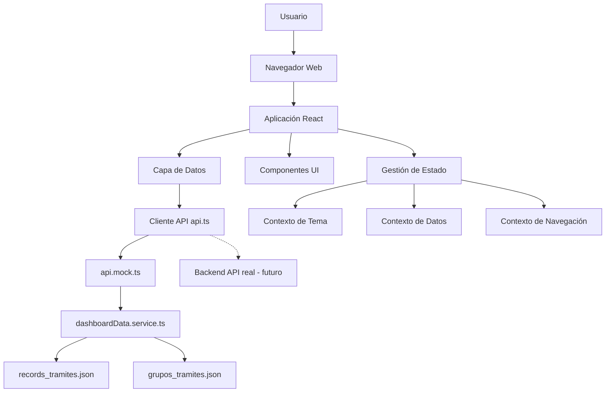
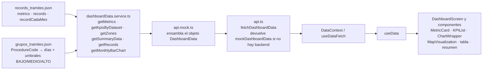
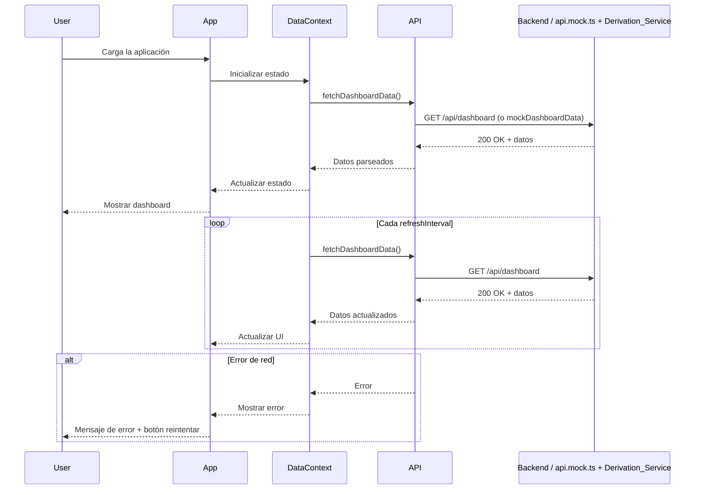
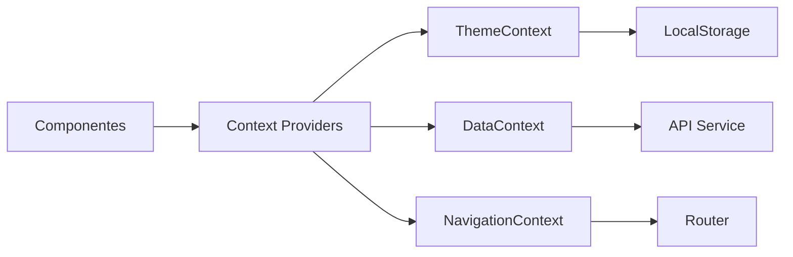
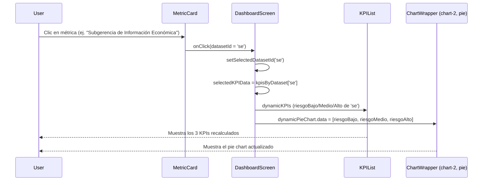

# Documento de Diseño - Dashboard Entidad

## Visión General

El Dashboard Entidad es una aplicación web de página única (SPA) construida con React que proporciona visualización de inteligencia de negocios en tiempo real. El sistema implementa una arquitectura basada en componentes con gestión de estado centralizada, actualizaciones automáticas de datos y capacidades de tematización.

### Objetivos del Diseño

- Proporcionar una interfaz de usuario responsiva y moderna para visualización de datos
- Implementar actualizaciones de datos en tiempo real con manejo robusto de errores
- Mantener una arquitectura escalable que permita agregar nuevas pantallas y métricas fácilmente
- Garantizar rendimiento óptimo incluso con múltiples diagramas y actualizaciones frecuentes
- Proporcionar una experiencia de usuario consistente con soporte para temas claro/oscuro
- Mantener los datos crudos separados de los valores derivados: dos archivos JSON como única fuente de datos y un servicio de derivación que calcula todo lo demás (Requerimiento 16)
- Mantener los colores y estilos exclusivamente en CSS, sin valores literales de color en archivos TypeScript (Requerimiento 17)
- Garantizar un orden de ejecución de hooks estable en la pantalla principal, ejecutando todos los hooks antes de cualquier retorno anticipado (Requerimiento 18)
- Aislar los espacios reservados pendientes de fuente definitiva (mapa ArcGIS Online) para que su reemplazo no afecte al resto de la arquitectura

## Arquitectura

### Arquitectura de Alto Nivel



### Capas de la Arquitectura

1. **Capa de Presentación**: Componentes React que renderizan la interfaz de usuario
2. **Capa de Gestión de Estado**: React Context API para estado global (tema, datos, navegación)
3. **Capa de Datos**: Servicios de obtención de datos con polling automático y manejo de errores
4. **Capa de API**: Cliente HTTP (`api.ts`) que se comunica con el backend o devuelve el mock ensamblado cuando no existe backend real
5. **Capa de Derivación de Datos**: `dashboardData.service.ts`, que lee los dos archivos JSON crudos y calcula todos los valores derivados que consume la interfaz (Requerimiento 16)

### Arquitectura de Datos: Dos Fuentes JSON y Servicio de Derivación

Toda la información del dashboard nace en exactamente dos archivos JSON de datos crudos (Requerimiento 16.1). Ninguno de ellos contiene valores derivados precalculados ni atributos de estilo (Requerimientos 16.20, 17.7).

#### Records_Tramites_File — `records_tramites.json` (raíz del proyecto)

Tres secciones:

| Sección | Contenido |
|---|---|
| `metrics` | Arreglo de 4 objetos; cada objeto asocia la clave de lectura de un Dataset (etiqueta antigua del JSON, no la etiqueta visible) con la tripleta `[riesgoBajo, riesgoMedio, riesgoAlto]` (Requerimiento 16.2) |
| `recordCadaMes` | `labels` (meses) más las series numéricas `total`, `gic`, `se`, `sifj` (Requerimiento 16.3) |
| `records` | Arreglo de registros crudos con `radicado`, `usuarioEncargado`, `dependencia`, `tipoTramite`, `codigoTramite`, `fechaRadicacion`, `dependenciaOrigen` (código corto GIC/SE/SIFJ) y `grupo` (categoría de trámite) (Requerimientos 16.4, 16.5) |

```json
{
  "metrics": [
    { "Solicitudes Totales": [696, 1663, 781] },
    { "Solicitudes Abiertas GIC": [67, 216, 41] },
    { "Solicitudes Abiertas SE": [270, 79, 15] },
    { "Solicitudes Abiertas SIFJ": [359, 1368, 725] }
  ],
  "recordCadaMes": {
    "labels": ["Oct", "Nov", "Dic", "Ene", "Feb", "Mar", "Abr", "May", "Jun", "Jul", "Ago", "Sep"],
    "total": [13, 29, 29, 49, 75, 132, 252, 799, 1202, 1873, 2760, 3251],
    "gic": [0, 0, 0, 3, 6, 16, 26, 55, 103, 196, 292, 324],
    "se": [0, 0, 0, 0, 0, 0, 5, 23, 91, 163, 274, 364],
    "sifj": [13, 27, 27, 40, 61, 97, 191, 641, 910, 1405, 2083, 2452]
  },
  "records": [
    {
      "radicado": "2026-1047514",
      "usuarioEncargado": "EDGAR ESTEVENS ESPAÑOL MORALES",
      "dependencia": "SUBGERENCIA INFORMACION FISICA  JURIDICA",
      "tipoTramite": "MODIFICACION ESTRATO USO Y DESTINO",
      "codigoTramite": 5,
      "fechaRadicacion": "2026-07-30",
      "dependenciaOrigen": "SIFJ",
      "grupo": "DINÁMICA"
    }
    /* ... 3251 registros en total ... */
  ]
}
```

Nótese que las claves de `metrics` ("Solicitudes Totales", "Solicitudes Abiertas GIC", etc.) son **claves de lectura** del archivo fuente, no las etiquetas visibles. El Derivation_Service las traduce al id interno con `LABEL_TO_DATASET_ID` y luego a la etiqueta visible con `DATASET_LABELS` (Requerimiento 16.2.1); el JSON no cambió al renombrar las etiquetas.

Nótese que cada Record trae **dos** representaciones de dependencia: `dependencia` (nombre largo descriptivo, sin uso actual en la derivación) y `dependenciaOrigen` (código corto GIC/SE/SIFJ, la fuente real de `SourceDependency`). El campo `grupo` (categoría de trámite, ej. "DINÁMICA", "CABIDA Y LINDEROS") no se consume en ninguna derivación actual.

Nótese que los registros **no** incluyen días asignados, días restantes ni estado de riesgo: los tres son valores calculados (Requerimiento 16.5). Este archivo vive en la raíz del proyecto (no en `src/mocks/`) porque es el archivo de datos operativos real. `recordCadaMes` se mantiene como una serie declarada (no calculada por el Derivation_Service); ver "Consideraciones Futuras" en `requirements.md` para una eventual derivación directa desde `records`.

#### Procedure_Groups_File — `grupos_tramites.json` (raíz del proyecto)

Mapa plano ProcedureCode (clave string) → objeto con días asignados y umbrales de riesgo (Requerimiento 16.6):

```json
{
  "5": {
    "DÍAS CALENDARIO": 30,
    "BAJO": 4,
    "MEDIO": 15,
    "ALTO": 24,
    "DEPENDENCIA": "SIFJ"
  },
  "74": {
    "DÍAS CALENDARIO": 90,
    "BAJO": 13,
    "MEDIO": 45,
    "ALTO": 72,
    "DEPENDENCIA": "SIFJ"
  }
}
```

- `DÍAS CALENDARIO`: días calendario asignados al ProcedureCode; alimenta `AllottedDays`.
- `BAJO` / `MEDIO`: umbrales de ElapsedDays (días transcurridos desde `fechaRadicacion`) usados como los dos únicos puntos de corte del RecordStatus (Requerimientos 16.14, 16.15, 16.16).
- `ALTO`: se conserva en el archivo pero **no se usa** como punto de corte (Requerimiento 16.16.3); es informativo para una futura cuarta categoría de riesgo o indicador visual.
- `DEPENDENCIA`: informativo; no se consume en la derivación porque la dependencia de cada Record ya viene en el Records_Tramites_File.

Este archivo vive en la raíz del proyecto (no en `src/mocks/`), igual que el Records_Tramites_File, porque es un archivo de datos operativos reales.

#### Derivation_Service — `src/services/dashboardData.service.ts`

Único módulo que lee los dos JSON. Expone seis funciones puras y no guarda estado:

```typescript
export function getMetrics(): Metric[];
export function getKpisByDataset(): KPIsByDataset;
export function getZones(): ZoneData[];
export function getSummaryData(): SummaryData;
export function getRecords(): DashboardRecord[];
export function getMonthlyBarChart(): { labels: string[]; datasets: Dataset[] }; // valores mensuales
```

Constantes internas que traducen el vocabulario del archivo crudo al vocabulario interno de la aplicación:

```typescript
/** [riesgoBajo, riesgoMedio, riesgoAlto] */
type RiskArray = [number, number, number];

/**
 * Traduce la clave de lectura de `metrics` (etiqueta antigua que sigue
 * en el JSON, NO es una etiqueta visible) al id interno del Dataset
 */
const LABEL_TO_DATASET_ID: Record<string, 'total' | 'gic' | 'se' | 'sifj'> = {
  'Solicitudes Totales': 'total',
  'Solicitudes Abiertas GIC': 'gic',
  'Solicitudes Abiertas SE': 'se',
  'Solicitudes Abiertas SIFJ': 'sifj',
};

/** Etiquetas visibles en la UI para cada Dataset (independientes de las claves del JSON) */
const DATASET_LABELS: Record<'total' | 'gic' | 'se' | 'sifj', LocationZone> = {
  total: 'Trámites Totales',
  gic: 'Gerencia de Información Catastral',
  se: 'Subgerencia de Información Económica',
  sifj: 'Subgerencia de Información Física y Jurídica',
};

/** Orden canónico de los Dataset; fija el orden de las 4 Location_Zone del mapa */
const DATASET_ORDER: Array<{ label: LocationZone; datasetId: 'total' | 'gic' | 'se' | 'sifj' }> = [
  { label: DATASET_LABELS.total, datasetId: 'total' },
  { label: DATASET_LABELS.gic, datasetId: 'gic' },
  { label: DATASET_LABELS.se, datasetId: 'se' },
  { label: DATASET_LABELS.sifj, datasetId: 'sifj' },
];

/** Una entrada de grupos_tramites.json, indexada por ProcedureCode (como string) */
interface RawGrupoTramite {
  'DÍAS CALENDARIO': number;
  BAJO: number;
  MEDIO: number;
  ALTO: number;
  DEPENDENCIA: string;
}
```

Helpers de derivación:

```typescript
/** Valor de una Metric = suma de su tripleta de riesgo (Requerimiento 16.7) */
function sumRisk([bajo, medio, alto]: RiskArray): number {
  return bajo + medio + alto;
}

/** Tripleta cruda -> desglose nombrado consumido por KPIs, pie chart y mapa (Req. 16.8) */
function toRiskBreakdown([bajo, medio, alto]: RiskArray): KPIRiskBreakdown {
  return { riesgoBajo: bajo, riesgoMedio: medio, riesgoAlto: alto };
}

**Nota de diseño sobre el origen del campo `dependency` de cada Record (bug corregido)**: el campo `dependencia` del Records_Tramites_File contiene nombres descriptivos largos (ej. `"SUBGERENCIA INFORMACION FISICA  JURIDICA"`), no los códigos cortos `GIC`/`SE`/`SIFJ` que usan los filtros de dependencia y el Sidebar. Usar ese campo directamente hacía que ningún Record calzara con esos filtros. `getRecords()` obtiene la Dependencia real desde `grupo.DEPENDENCIA` (el mismo objeto de `grupos_tramites.json` consultado por `codigoTramite` para `allottedDays` y `status`), con fallback al campo `dependencia` original solo si el ProcedureCode no tiene grupo asociado (Requerimientos 16.11.1, 16.11.2).

```typescript
dependency: grupo?.DEPENDENCIA ?? raw.dependencia,
```

**Nota de diseño sobre `sourceDependency` (segunda corrección)**: la primera versión de `sourceDependency` leía el campo `dependencia` (nombre largo), asumiendo que era la única fuente de "dependencia de origen" disponible. Una actualización posterior de `records_tramites.json` agregó el campo `dependenciaOrigen`, que es el código corto real (GIC/SE/SIFJ) pensado para este propósito. `getRecords()` se corrigió para leer `sourceDependency` desde `raw.dependenciaOrigen`, y las constantes `GIC_SOURCE_DEPENDENCY`/`SIFJ_SOURCE_DEPENDENCY` de ambas Screens pasaron de los nombres largos a los códigos cortos `'GIC'`/`'SIFJ'` (Requerimiento 16.11.3).

```typescript
sourceDependency: raw.dependenciaOrigen,
```

/**
 * RecordStatus a partir de los días transcurridos (ElapsedDays) y los
 * umbrales BAJO/MEDIO del grupo de trámite del Record (Requerimientos
 * 16.14, 16.15, 16.16, 16.16.1, 16.16.2, 16.16.3).
 * elapsedDays <= BAJO  -> Riesgo Bajo
 * BAJO < elapsedDays <= MEDIO -> Riesgo Medio
 * elapsedDays > MEDIO  -> Riesgo Alto
 * Sin grupo para el ProcedureCode -> Riesgo Alto (fallback de seguridad)
 * elapsedDays < 0 (fecha de radicación futura) -> Riesgo Bajo
 * ALTO no se usa como punto de corte; es informativo.
 */
function calculateRiskStatus(elapsedDays: number, grupo: RawGrupoTramite | undefined): RecordStatus {
  if (!grupo) return 'Riesgo Alto';
  if (elapsedDays < 0) return 'Riesgo Bajo';
  if (elapsedDays <= grupo.BAJO) return 'Riesgo Bajo';
  if (elapsedDays <= grupo.MEDIO) return 'Riesgo Medio';
  return 'Riesgo Alto';
}
```

#### Mapeo clave JSON → id interno → etiqueta visible

Las claves de `metrics` en `records_tramites.json` se usan solo como claves de lectura. La etiqueta que ve el usuario (tarjetas de métricas, zonas del mapa y leyenda de "Registros por mes") sale de `DATASET_LABELS` (Requerimiento 16.2.1):

| Clave de lectura en el JSON (`LABEL_TO_DATASET_ID`) | Id interno | Etiqueta visible (`DATASET_LABELS`) |
|---|---|---|
| `Solicitudes Totales` | `total` | Trámites Totales |
| `Solicitudes Abiertas GIC` | `gic` | Gerencia de Información Catastral |
| `Solicitudes Abiertas SE` | `se` | Subgerencia de Información Económica |
| `Solicitudes Abiertas SIFJ` | `sifj` | Subgerencia de Información Física y Jurídica |

Uso en las funciones públicas:

```typescript
// getMetrics(): la clave del JSON solo sirve para resolver el id; la etiqueta sale de DATASET_LABELS
label: DATASET_LABELS[LABEL_TO_DATASET_ID[label]],

// getZones(): DATASET_ORDER ya trae la etiqueta visible tipada como LocationZone
return { zone: label, approved: risk.riesgoBajo, pending: risk.riesgoMedio, rejected: risk.riesgoAlto };

// getMonthlyBarChart()
datasets: [
  { id: 'total', label: DATASET_LABELS.total, data: total },
  { id: 'gic', label: DATASET_LABELS.gic, data: gic },
  { id: 'se', label: DATASET_LABELS.se, data: se },
  { id: 'sifj', label: DATASET_LABELS.sifj, data: sifj },
],
```

#### Reglas de derivación

| Valor derivado | Regla | Requerimiento |
|---|---|---|
| `Metric.value` | Suma de los tres elementos de la tripleta de riesgo del Dataset, leída del Records_Tramites_File | 16.7 |
| `kpisByDataset` | `toRiskBreakdown` de la tripleta de cada Dataset, leída del Records_Tramites_File | 16.8 |
| `zones` (4 Location_Zone) | Del mismo desglose de riesgo: `riesgoBajo → approved`, `riesgoMedio → pending`, `riesgoAlto → rejected`, en el orden de `DATASET_ORDER` | 16.9 |
| `summaryData.total` | Valor de la Metric del Dataset `total` | 16.10, 14.2 |
| `summaryData.approved/pending/rejected` | Suma de GIC + SE + SIFJ por nivel de riesgo, sin usar el Dataset `total` | 16.10, 14.3 |
| `allottedDays` | `gruposTramites[String(record.codigoTramite)]?.['DÍAS CALENDARIO']`, con fallback `0` si el ProcedureCode no existe | 16.11, 16.12 |
| `daysUntilDue` | `allottedDays - elapsedDays(fechaRadicacion, hoy)` | 16.13, 12.5 |
| `status` (RecordStatus) | `calculateRiskStatus(elapsedDays, grupo)`: `elapsedDays <= BAJO` Riesgo Bajo; `BAJO < elapsedDays <= MEDIO` Riesgo Medio; `elapsedDays > MEDIO` Riesgo Alto; sin grupo Riesgo Alto; `elapsedDays < 0` Riesgo Bajo | 16.14 – 16.16.3 |
| Series de `chart-3` (barras, "Registros por mes") | Valores mensuales de `recordCadaMes`, sin transformar | 16.17 |

Todos estos valores se calculan en tiempo de lectura, en cada invocación del servicio (Requerimiento 16.19). El servicio no persiste nada y los JSON no contienen ningún resultado intermedio (Requerimiento 16.20).

**Nota de diseño sobre `getSummaryData()`**: la función mezcla deliberadamente dos fuentes internas del mismo archivo. "Total Solicitudes" se toma del Dataset "Trámites Totales", mientras que los tres totales de riesgo se calculan sumando GIC + SE + SIFJ y **no** usan la tripleta del Dataset `total`. Esto refleja la regla de negocio confirmada (Requerimiento 14.3): el total general es un dato declarado, y el desglose de riesgo global es la agregación de las tres dependencias.

**Nota de diseño sobre el origen de `metrics`, `records` y `recordCadaMes`**: las tres secciones se leen desde el Records_Tramites_File (`records_tramites.json`, en la raíz del proyecto), importado en el servicio como `recordsTramitesJson`. El servicio expone tres referencias internas derivadas de ese mismo import —`rawMetrics`, `rawRecords` y `rawRecordCadaMes`— para que `getMetrics()`, `getKpisByDataset()`, `getRecords()` y `getMonthlyBarChart()` lean cada uno la sección que les corresponde. Ya no existe un `dashboardData.json` ni una referencia `rawData` separada: el Records_Tramites_File es la única fuente de datos operativos, junto con el Procedure_Groups_File para días y umbrales de riesgo.

**Nota de diseño sobre la eliminación del diagrama de evolución interactivo (antiguo `chart-1`)**: por decisión del usuario se retiró el diagrama "Evolución solicitudes" y todo su código exclusivo: la función `getEvolutionChart()` y el helper `accumulate()` en `dashboardData.service.ts`, el componente `InteractiveChart.tsx`, la rama de `ChartWrapper` que lo renderizaba, y las props `selectedDatasetId`/`onDatasetChange` de `ChartWrapperProps`. `recordCadaMes` se mantiene como fuente exclusiva de `getMonthlyBarChart()` (`chart-3`, "Registros por mes"), que ahora expone `id` en cada `Dataset` (`total`, `gic`, `se`, `sifj`) porque `metricsWithCalculatedChange` en `DashboardScreen` pasó a leer de `chart-3` en vez de `chart-1` para calcular el `changePercent` de las 4 MetricCard (Requerimiento 2.3).

```typescript
export function getSummaryData(): SummaryData {
  const { gic, se, sifj } = getKpisByDataset();
  const totalValue = getMetrics().find((m) => m.datasetId === 'total')?.value ?? 0;
  return {
    total: totalValue,
    approved: gic.riesgoBajo + se.riesgoBajo + sifj.riesgoBajo,
    pending: gic.riesgoMedio + se.riesgoMedio + sifj.riesgoMedio,
    rejected: gic.riesgoAlto + se.riesgoAlto + sifj.riesgoAlto,
  };
}
```

#### Flujo completo de datos



Responsabilidad de cada eslabón (Requerimiento 16.18):

1. **Los dos JSON** aportan exclusivamente datos de negocio crudos: `records_tramites.json` (metrics, records, recordCadaMes) y `grupos_tramites.json` (días asignados y umbrales de riesgo por ProcedureCode).
2. **`dashboardData.service.ts`** deriva métricas, desglose de riesgo, zonas, resumen, registros y series de los diagramas.
3. **`api.mock.ts`** ensambla el objeto `DashboardData` completo: invoca las seis funciones del servicio, define los dos `ChartConfig` (`chart-2` circular con el desglose del Dataset `total` como estado inicial, `chart-3` barras) y el `lastUpdate`.
4. **`api.ts`** expone `fetchDashboardData()`. Cuando `shouldUseMockData()` es verdadero (comportamiento por defecto, controlado por `VITE_USE_MOCK_DATA`) devuelve `mockDashboardData` tras un retardo simulado; en caso contrario hace `GET /api/dashboard` contra el backend real con timeout de 5 s.
5. **`DataContext` / `useDataFetch`** aplican polling, reintentos y estados de carga/error, y publican los datos vía `useData`.
6. **`DashboardScreen` y los componentes** consumen el objeto ya derivado y solo recalculan lo que depende de la interacción del usuario (dataset seleccionado, filtros de la tabla, `changePercent`).

Sustituir los dos JSON por endpoints reales solo requiere reemplazar las lecturas del servicio de derivación: el contrato de datos crudos y las reglas de derivación permanecen iguales.

### Patrones Arquitectónicos

- **Component-Based Architecture**: Todo el UI se construye con componentes React reutilizables
- **Container/Presenter Pattern**: Separación entre componentes de lógica (containers) y presentación (presenters)
- **Custom Hooks**: Encapsulación de lógica reutilizable (useDataFetch, useTheme, usePolling)
- **Context API**: Gestión de estado global sin necesidad de props drilling
- **Error Boundaries**: Manejo robusto de errores a nivel de componente

## Estructura de Carpetas

```
dashboard-entidad/
├── records_tramites.json       # Records_Tramites_File (metrics + records), en la raíz
├── grupos_tramites.json        # Procedure_Groups_File (días + umbrales por ProcedureCode), en la raíz
├── public/
│   ├── index.html
│   └── favicon.ico
├── src/
│   ├── components/
│   │   ├── common/
│   │   │   ├── LoadingSpinner.tsx
│   │   │   ├── ErrorMessage.tsx
│   │   │   └── ThemeToggle.tsx
│   │   ├── layout/
│   │   │   ├── Header.tsx
│   │   │   ├── Sidebar.tsx
│   │   │   ├── MainLayout.tsx
│   │   │   └── WelcomeMessage.tsx
│   │   ├── metrics/
│   │   │   ├── MetricCard.tsx
│   │   │   └── MetricList.tsx
│   │   ├── kpis/
│   │   │   ├── KPICard.tsx
│   │   │   ├── TrendIndicator.tsx
│   │   │   └── KPIList.tsx
│   │   ├── charts/
│   │   │   ├── BarChart.tsx
│   │   │   ├── LineChart.tsx
│   │   │   ├── PieChart.tsx
│   │   │   └── ChartWrapper.tsx
│   │   ├── records/
│   │   │   └── RecordsTable.tsx
│   │   ├── map/
│   │   │   └── MapVisualization.tsx
│   │   └── summary/
│   │       └── SummaryPanel.tsx
│   ├── contexts/
│   │   ├── ThemeContext.tsx
│   │   ├── DataContext.tsx
│   │   └── NavigationContext.tsx
│   ├── hooks/
│   │   ├── useDataFetch.ts
│   │   ├── usePolling.ts
│   │   ├── useTheme.ts
│   │   └── useNavigation.ts
│   ├── mocks/
│   │   └── api.mock.ts             # ensambla el objeto DashboardData
│   ├── services/
│   │   ├── api.ts
│   │   ├── dashboardData.service.ts # Derivation_Service
│   │   └── storageService.ts
│   ├── types/
│   │   ├── dashboard.types.ts
│   │   ├── metric.types.ts
│   │   └── kpi.types.ts
│   ├── utils/
│   │   ├── formatters.ts
│   │   ├── validators.ts
│   │   └── constants.ts
│   ├── screens/
│   │   ├── DashboardScreen.tsx
│   │   ├── SifjScreen.tsx
│   │   └── index.ts
│   ├── styles/
│   │   ├── themes.ts
│   │   └── globals.css
│   ├── App.tsx
│   └── index.tsx
├── package.json
├── tsconfig.json
├── tailwind.config.js
└── vite.config.ts
```

### Explicación de la Estructura

- **components/**: Componentes React organizados por funcionalidad
  - **common/**: Componentes compartidos (spinners, mensajes de error, controles de tema)
  - **layout/**: Componentes de estructura principal (header, sidebar, layout, mensaje de bienvenida)
  - **metrics/**: Componentes para mostrar métricas operativas
  - **kpis/**: Componentes para KPIs con indicadores de tendencia
  - **charts/**: Componentes de visualización de datos
  - **records/**: Componentes para tabla de registros
  - **map/**: Componentes para visualización de mapa geográfico
  - **summary/**: Componentes para panel de resumen
- **contexts/**: Proveedores de contexto React para estado global
- **hooks/**: Custom hooks reutilizables
- **mocks/**: Ensamblado del objeto `DashboardData` (`api.mock.ts`). El Records_Tramites_File (`records_tramites.json`) y el Procedure_Groups_File (`grupos_tramites.json`) viven en la raíz del proyecto, no en esta carpeta
- **services/**: Lógica de negocio, derivación de datos (`dashboardData.service.ts`) y llamadas API
- **types/**: Definiciones de tipos TypeScript
- **utils/**: Funciones utilitarias y constantes
- **screens/**: Componentes de pantalla principal
- **styles/**: Configuración de temas y estilos globales. `globals.css` es la **única** fuente de los colores de los diagramas (variables `--chart-*`); no existe ningún módulo TypeScript de colores de gráficos (Requerimiento 17.6)

## Componentes e Interfaces

### Componentes Principales

#### 1. MainLayout

Componente contenedor principal que estructura toda la aplicación.

```typescript
interface MainLayoutProps {
  children: React.ReactNode;
}

const MainLayout: React.FC<MainLayoutProps> = ({ children }) => {
  return (
    <div className="app-container">
      <Sidebar />
      <div className="main-content">
        <Header />
        {children}
      </div>
    </div>
  );
};
```

#### 2. Header

Muestra el título del dashboard y el control de tema. **El Header ya NO renderiza visualmente la marca de tiempo de última actualización ni incluye un botón "Cerrar sesión"** (ver Requerimiento 8.3 y la sección "Consideraciones Futuras" de requirements.md). El componente sigue aceptando `lastUpdate` como prop por compatibilidad con `MainLayout`, pero no lo utiliza en el render; ese dato se mantiene únicamente en el estado interno (`DataContext`) para uso futuro/depuración.

```typescript
interface HeaderProps {
  lastUpdate: Date | null; // recibido pero NO renderizado
}

const Header = ({ lastUpdate: _lastUpdate }: HeaderProps) => {
  return (
    <header className="bg-white dark:bg-slate-900 border-b border-gray-200 dark:border-gray-700 px-6 py-4">
      <div className="flex items-center justify-between">
        <h1 className="text-2xl font-bold text-primary">Dashboard Entidad</h1>
        <ThemeToggle />
      </div>
    </header>
  );
};
```

#### 3. Sidebar

Panel de navegación lateral para cambiar entre pantallas. Utiliza el tipo `Screen` (ver `navigation.types.ts`), que expone el campo **`label`**, no `name`.

> **Nota de bug corregido:** una versión anterior de este componente intentaba leer `item.name` mientras que `Screen` define `label`. Esto causaba que ningún texto de navegación se mostrara en el Sidebar. El componente actual usa `item.label` consistentemente y esto debe mantenerse en cualquier refactor futuro.

```typescript
interface SidebarProps {
  items: Screen[]; // Screen.label, NO Screen.name
  activeItem: string;
  onItemClick: (itemId: string) => void;
}

const Sidebar = ({ items, activeItem, onItemClick }: SidebarProps) => {
  return (
    <aside className="w-64 bg-blue-900 dark:bg-gray-800 min-h-screen border-r border-gray-200 dark:border-gray-700 flex flex-col">
      <div className="flex-1 p-6">
        <h2 className="text-xl font-bold text-white mb-6">Dashboard</h2>
        <nav className="space-y-2">
          {items.map((item) => {
            const isActive = item.id === activeItem;
            return (
              <button
                key={item.id}
                onClick={() => onItemClick(item.id)}
                className={`w-full flex items-center gap-3 px-4 py-3 rounded-lg transition-colors text-left ${
                  isActive
                    ? 'bg-white/10 text-white font-medium'
                    : 'text-white/70 hover:bg-white/5 hover:text-white'
                }`}
              >
                {item.icon && <span className="text-xl">{item.icon}</span>}
                <span>{item.label}</span>
                {isActive && (/* ícono de check */ null)}
              </button>
            );
          })}
        </nav>
      </div>
      <div className="p-6 border-t border-white/10">
        <p className="text-xs text-white/50 text-center">Dashboard Entidad v1.0</p>
      </div>
    </aside>
  );
};
```

Por defecto, `NavigationProvider` registra dos ítems: `{ id: 'dashboard', label: 'GIC' }` (Requerimiento 10.6) y `{ id: 'sifj', label: 'SIFJ' }` (Requerimiento 19.1). Nuevos ítems pueden agregarse dinámicamente vía `addScreen`.

`App.tsx` decide qué pantalla renderizar leyendo `currentScreen` del `useNavigation()`: `currentScreen === 'sifj'` renderiza `SifjScreen`, cualquier otro valor renderiza `DashboardScreen` (Requerimiento 19.2). El campo `component` de `Screen` se declara en el tipo pero no se usa para este enrutamiento; `App.tsx` mapea el `id` manualmente.

#### 4. MetricCard

Muestra una métrica individual con etiqueta, valor, unidad y porcentaje de cambio. Además de su rol como tarjeta informativa, `MetricCard` funciona como **selector de dataset** para el diagrama circular (`chart-2`) y los KPIs: puede recibir `isClickable`, `isSelected` y `onClick`.

```typescript
interface MetricCardProps {
  metric: Metric; // metric.datasetId vincula la card con un dataset (Riesgo Bajo/Medio/Alto de KPIs y chart-2)
  isClickable?: boolean;
  isSelected?: boolean;
  onClick?: () => void;
}

const MetricCard = ({ metric, isClickable = false, isSelected = false, onClick }: MetricCardProps) => {
  const isPositive = (metric.changePercent ?? 0) >= 0;

  // Cuando isSelected es true, la card recibe un anillo/borde azul y texto resaltado
  // Cuando isClickable es true, la card se renderiza como <button> con hover/scale
  // ...
};
```

**Cálculo de `changePercent` (Requerimiento 2.3):** el valor de cambio porcentual mostrado ya NO es un valor fijo del mock. `DashboardScreen` lo recalcula para cada métrica comparando los dos últimos valores mensuales del array `data` del dataset del diagrama de barras "Registros por mes" (`chart-3`) cuyo `id` coincide con `metric.datasetId`:

```typescript
const monthlyChart = dashboardData.charts.find(chart => chart.id === 'chart-3');
const metricsWithCalculatedChange = dashboardData.metrics.map((metric) => {
  const dataset = monthlyChart?.data.datasets.find(d => d.id === metric.datasetId);
  if (!dataset || dataset.data.length < 2) return metric;
  const previous = dataset.data[dataset.data.length - 2];
  const current = dataset.data[dataset.data.length - 1];
  const changePercent = previous !== 0 ? ((current - previous) / previous) * 100 : 0;
  return { ...metric, changePercent: Math.round(changePercent * 10) / 10 };
});
```

Esto requiere que `getMonthlyBarChart()` asigne un `id` (`total`, `gic`, `se`, `sifj`) a cada `Dataset` de `chart-3`, algo que antes no necesitaba porque solo se usaba para renderizar el `BarChart`.

#### 5. KPICard

Muestra un KPI con su valor actual y una insignia de estado. **`targetValue` se usa internamente para calcular el estado pero NO se muestra en la UI** (Requerimiento 3.2), y **ya no se renderiza `TrendIndicator`** (Requerimiento 3.6). El tipo `KPI` conserva el campo `targetValue` porque el cálculo de estado sigue basándose en la comparación `currentValue`/`targetValue`, pero el componente no lo imprime en ningún elemento visible.

```typescript
interface KPICardProps {
  kpi: KPI;
}

const KPICard = ({ kpi }: KPICardProps) => {
  const status = kpi.status || getKPIStatus(kpi.currentValue, kpi.targetValue);

  const statusColors = {
    success: 'border-green-400 dark:border-green-600 bg-green-50 dark:bg-green-900/20',
    warning: 'border-yellow-400 dark:border-yellow-600 bg-yellow-50 dark:bg-yellow-900/20',
    error: 'border-red-400 dark:border-red-600 bg-red-50 dark:bg-red-900/20',
  };

  const statusTextColors = {
    success: 'text-green-700 dark:text-green-400',
    warning: 'text-yellow-700 dark:text-yellow-400',
    error: 'text-red-700 dark:text-red-400',
  };

  return (
    // border-2 (borde completo alrededor de toda la card, no border-l-4 lateral)
    <div className={`p-6 rounded-lg border-2 transition-all hover:shadow-lg ${statusColors[status]}`}>
      <div className="mb-4">
        <h3 className="text-lg font-semibold text-secondary">{kpi.label}</h3>
      </div>
      <div className="space-y-2">
        <div>
          <span className="text-3xl font-bold">{kpi.currentValue.toLocaleString()}</span>
          <span className="text-sm text-secondary ml-2">{kpi.unit}</span>
        </div>
        {/* Badge de estado alineado a la derecha, sin ícono de tendencia */}
        <div className="pt-2 text-right">
          <span className={`inline-block px-2 py-1 rounded text-xs font-medium ${statusTextColors[status]}`}>
            {status === 'success' && 'A tiempo por contestar'}
            {status === 'warning' && 'Riesgo del tiempo de vencimiento'}
            {status === 'error' && 'Cerca de tiempo de vencimiento'}
          </span>
        </div>
      </div>
    </div>
  );
};
```

**Mapeo de estado a texto de la insignia (Requerimientos 3.3, 3.4, 3.5):**

| Estado | Texto de la insignia |
|---|---|
| `success` | "A tiempo por contestar" |
| `warning` | "Riesgo del tiempo de vencimiento" |
| `error` | "Cerca de tiempo de vencimiento" |

#### 6. ChartWrapper

Componente wrapper que selecciona y renderiza el tipo de gráfico adecuado (`bar`, `line`/`area`, `pie`), con manejo de carga y errores. Soporta la prop opcional `dynamicTitle` para sobrescribir el título del gráfico.

```typescript
interface ChartWrapperProps {
  chart: ChartConfig;
  isLoading?: boolean;
  error?: string;
  onRetry?: () => void;
  dynamicTitle?: string;           // título dinámico opcional
}

const ChartWrapperComponent = ({
  chart, isLoading = false, error, onRetry, dynamicTitle
}: ChartWrapperProps) => {
  if (isLoading) return <LoadingSpinner />;
  if (error) return <ErrorMessage message={error} onRetry={onRetry} />;

  const renderChart = () => {
    switch (chart.type) {
      case 'bar': return <BarChart data={chart.data} />;
      case 'line':
      case 'area': return <LineChart data={chart.data} />;
      case 'pie': return <PieChart data={chart.data} />;
      default: return <div>Tipo de gráfico no soportado: {chart.type}</div>;
    }
  };

  return (
    <div className="bg-white dark:bg-slate-900 p-6 rounded-lg border border-gray-200 dark:border-gray-700">
      <h3 className="text-lg font-semibold mb-4">{dynamicTitle || chart.title}</h3>
      <div className="w-full">{renderChart()}</div>
    </div>
  );
};

export const ChartWrapper = memo(ChartWrapperComponent);
```

**BarChart**: acepta la prop opcional `stacked?: boolean` (por defecto `false`; sin ella el componente se comporta como antes). Cuando es `true`, todas las series comparten `stackId="stack"` (una sola barra por categoría con tramos apilados) y cada `<Bar>` incluye un `<LabelList>` que escribe el conteo dentro del tramo y omite los ceros. El texto usa `--chart-segment-label` (sin alpha). El eje X conserva su configuración original: `angle={horizontalLabels ? 0 : -30}` y `height={horizontalLabels ? 30 : 50}`.

```typescript
// BarChart.tsx — rama stacked
<Bar dataKey={dataset.label} stackId={stacked ? 'stack' : undefined} fill={color}>
  {stacked && (
    <LabelList
      dataKey={dataset.label}
      position="center"
      fill="rgb(var(--chart-segment-label))"
      fontSize={12}
      fontWeight={600}
      formatter={(value: number) => (value > 0 ? value : '')}
    />
  )}
</Bar>
```

**PieChart**: El `Tooltip` de Recharts define explícitamente `contentStyle` (`backgroundColor: var(--color-surface)`, `border: 1px solid var(--color-border)`), `itemStyle` (`color: var(--color-text)`) y `labelStyle` (`color: var(--color-text)`) para que el tooltip sea legible tanto en tema claro como en tema oscuro (Requerimiento 4.7).

> `InteractiveChart.tsx` fue eliminado junto con el diagrama de evolución interactivo (antiguo `chart-1`). `ChartWrapper` ya no tiene una rama para gráficos interactivos: todos los `ChartConfig` se resuelven directamente por `chart.type` (`bar`, `line`/`area`, `pie`).

#### 7. Mensaje de bienvenida

No existe un componente `WelcomeMessage` separado; el mensaje de bienvenida se renderiza inline en `DashboardScreen`. Consiste **únicamente en un `<h2>`** con el texto "Bienvenido!", **sin subtítulo secundario** (Requerimiento 1.5):

```typescript
<div className="bg-gradient-to-r from-blue-600 to-blue-800 text-white p-6 rounded-lg">
  <h2 className="text-2xl font-bold mb-2">Bienvenido!</h2>
</div>
```

#### 8. Tabla de Registros (inline en DashboardScreen)

No existe un componente `RecordsTable` separado ni columna de "Acciones" ni botón "Ver todos". La tabla vive directamente en `DashboardScreen`, con **10 columnas** (Radicado, Usuario Encargado, Dependencia, Tipo de Trámite, Grupo, Código de Trámite, Días por Trámite, Estado, Fecha de Radicación, Días Restantes), desplazamiento vertical (`max-h-96 overflow-y-auto`) y controles de filtro en la cabecera de la sección: estado, usuario encargado, tipo de trámite, rango de fechas (desde/hasta) y días restantes.

**Acotamiento a GIC (Requerimiento 12.1, 12.7)**: esta tabla ya no muestra todos los `dashboardData.records`. Se filtra primero por `sourceDependency === 'GIC'` (la constante `GIC_SOURCE_DEPENDENCY`), y solo sobre ese subconjunto se generan las opciones de los dropdowns de usuario encargado y tipo de trámite, y se aplican los demás filtros. Por eso ya no existe un dropdown de filtro por Dependencia: el conjunto de datos ya está fijado a GIC.

```typescript
// Records table on this screen is scoped to the GIC dependency, matched
// against the original source `dependenciaOrigen` field (short code).
const GIC_SOURCE_DEPENDENCY = 'GIC';

// Estado local en DashboardScreen (ya sin dependencyFilter)
const [statusFilter, setStatusFilter] = useState<string>('Todos');
const [procedureTypeFilter, setProcedureTypeFilter] = useState<string>('Todos');
const [dateFrom, setDateFrom] = useState<string>('');
const [dateTo, setDateTo] = useState<string>('');
const [daysUntilDueFilter, setDaysUntilDueFilter] = useState<string>('Todos');

// Records scoped to GIC before any filter dropdown option is computed
const gicRecords = dashboardData.records.filter(
  (record) => record.sourceDependency === GIC_SOURCE_DEPENDENCY
);

// Días Restantes recalculado: allottedDays - días transcurridos desde filingDate
const recordsWithCalculatedDaysUntilDue = gicRecords.map((record) => {
  const filingDate = new Date(record.filingDate);
  const elapsedDays = Math.floor((Date.now() - filingDate.getTime()) / (1000 * 60 * 60 * 24));
  return { ...record, daysUntilDue: record.allottedDays - elapsedDays };
});

// Filtrado combinado (AND) por los 4 criterios restantes
const filteredRecords = recordsWithCalculatedDaysUntilDue.filter((record) => {
  if (statusFilter !== 'Todos' && record.status !== statusFilter) return false;
  if (procedureTypeFilter !== 'Todos' && record.procedureType !== procedureTypeFilter) return false;
  if (dateFrom && record.filingDate < dateFrom) return false;
  if (dateTo && record.filingDate > dateTo) return false;
  if (daysUntilDueFilter === 'Vencido' && record.daysUntilDue > 0) return false;
  if (daysUntilDueFilter === '1-3' && (record.daysUntilDue < 1 || record.daysUntilDue > 3)) return false;
  if (daysUntilDueFilter === '4-7' && (record.daysUntilDue < 4 || record.daysUntilDue > 7)) return false;
  if (daysUntilDueFilter === '8+' && record.daysUntilDue < 8) return false;
  return true;
});
```
```

Las opciones del filtro de Tipo de Trámite se generan dinámicamente a partir de los `procedureType` únicos presentes en `dashboardData.records` (Requerimiento 12.9).

#### 9. MapVisualization

Muestra la distribución de las 4 `Location_Zone` (tipos de solicitud: Trámites Totales, Gerencia de Información Catastral, Subgerencia de Información Económica, Subgerencia de Información Física y Jurídica), cada una con su desglose de riesgo. **Ya no reduce zonas geográficas** — el tipo `LocationZone` fue redefinido para representar tipos de solicitud, no puntos cardinales.

```typescript
interface MapVisualizationProps {
  zones: ZoneData[]; // 4 zonas: una por cada Location_Zone
  isLoading?: boolean;
  error?: string;
  onRetry?: () => void;
}

const MapVisualization = ({ zones, isLoading = false, error, onRetry }: MapVisualizationProps) => {
  // ...loading/error states...
  return (
    <div className="bg-white dark:bg-slate-900 p-6 rounded-lg border border-gray-200 dark:border-gray-700 h-full">
      <h3 className="text-lg font-semibold">Mapa de ubicaciones</h3>
      <p className="text-sm text-secondary">Distribución geográfica por intensidad</p>

      {/* Placeholder visual de ArcGIS Online, integración pendiente */}
      <div className="relative bg-gray-100 dark:bg-gray-800 rounded-lg overflow-hidden" style={{ height: '300px' }}>
        {/* ícono + texto "Mapa ArcGIS Online / Integración pendiente" */}
      </div>

      {/* Resumen por cada una de las 4 Location_Zone: solo nombre y total */}
      <div className="mt-4 grid grid-cols-4 gap-2">
        {zones.slice(0, 4).map((zone) => {
          const total = zone.approved + zone.pending + zone.rejected;
          return (
            <div key={zone.zone} className="bg-gray-50 dark:bg-gray-800 p-2 rounded text-center">
              <p className="text-xs font-semibold">{zone.zone}</p>
              <p className="text-lg font-bold">{total}</p>
            </div>
          );
        })}
      </div>

      {/* Leyenda: verde/amarillo/rojo */}
    </div>
  );
};
```

En `ZoneData`, los campos `approved`/`pending`/`rejected` se reutilizan conceptualmente para representar `riesgoBajo`/`riesgoMedio`/`riesgoAlto` del dataset asociado a esa `Location_Zone` (Requerimiento 13.2). El servicio de derivación construye las 4 zonas desde `kpisByDataset` siguiendo el orden de `DATASET_ORDER` (Requerimiento 16.9).

Cada card muestra **únicamente** el nombre de la `Location_Zone` y el total, calculado como la suma de los tres niveles de riesgo (Requerimiento 13.5). El porcentaje de aprobación (`approvalRate`) fue **eliminado** del componente por decisión del usuario y quedó registrado en las consideraciones futuras de `requirements.md`; el cálculo ya no existe en el código.

El área del mapa sigue siendo un **espacio reservado** con el ícono y los textos "Mapa ArcGIS Online" / "Integración pendiente", a la espera de la integración real con ArcGIS Online (Requerimiento 13.7).

#### 10. Panel de Resumen (inline en DashboardScreen)

No existe un componente `SummaryPanel` separado; las 4 cards de resumen se renderizan inline en `DashboardScreen`: Total Solicitudes, Total Riesgo Bajo, Total Riesgo Medio, Total Riesgo Alto. **Estas cards ya no usan `dashboardData.summaryData`** (que agregaba GIC + SE + SIFJ a nivel de Dataset): se calculan contando `gicRecords` (los mismos registros filtrados por `sourceDependency === 'GERENCIA DE INFORMACION CATASTRAL'` que alimentan la tabla de la sección 8) agrupados por `status`, igual que hace `SifjScreen` con sus propios registros (Requerimiento 14.2):

```typescript
const totalSolicitudesGic = gicRecords.length;
const totalRiesgoBajoGic = gicRecords.filter((r) => r.status === 'Riesgo Bajo').length;
const totalRiesgoMedioGic = gicRecords.filter((r) => r.status === 'Riesgo Medio').length;
const totalRiesgoAltoGic = gicRecords.filter((r) => r.status === 'Riesgo Alto').length;
```

`dashboardData.summaryData` (`getSummaryData()` en el Derivation_Service) se mantiene en el contrato de datos por compatibilidad con los tests existentes, pero ya no tiene ningún consumidor visual: ni `DashboardScreen` ni `SifjScreen` lo usan.

#### 11. DashboardScreen (orquestador central)

`DashboardScreen` concentra la mayoría del estado y lógica derivada de la pantalla principal, ya que los componentes de bienvenida, resumen y tabla de registros viven inline en él (ver puntos 7, 8 y 10). Mantiene el siguiente estado local:

```typescript
const [selectedDatasetId, setSelectedDatasetId] = useState<string>('total'); // default (Req. 2.7, 15.5)
const [statusFilter, setStatusFilter] = useState<string>('Todos');
const [procedureTypeFilter, setProcedureTypeFilter] = useState<string>('Todos');
const [dateFrom, setDateFrom] = useState<string>('');
const [dateTo, setDateTo] = useState<string>('');
const [daysUntilDueFilter, setDaysUntilDueFilter] = useState<string>('Todos');
```

Y calcula dinámicamente, en cada render:

- **`metricsWithCalculatedChange`**: `changePercent` de cada métrica recalculado desde los 2 últimos valores mensuales del dataset asociado en `chart-3` (ver componente 4, Requerimiento 2.3).
- **`totalRiesgoBajo` / `totalRiesgoMedio` / `totalRiesgoAlto`**: suma de `kpisByDataset.gic` + `.se` + `.sifj` para el panel de resumen (componente 10, Requerimiento 14.2).
- **`recordsWithCalculatedDaysUntilDue`**: `daysUntilDue` recalculado como `allottedDays - días transcurridos desde filingDate` (componente 8, Requerimiento 12.5).
- **`filteredRecords`**: registros que cumplen simultáneamente los 5 filtros activos (componente 8, Requerimiento 12.12).
- **`selectedKPIData`**: `dashboardData.kpisByDataset[selectedDatasetId]`, el desglose de riesgo del dataset actualmente seleccionado.
- **`dynamicKPIs`**: los 3 KPIs de la sección "Indicadores de Desempeño", construidos con `currentValue` igual a `riesgoBajo`/`riesgoMedio`/`riesgoAlto` de `selectedKPIData` (Requerimiento 15.1).
- **Pie chart dinámico (`chart-2`)**: se reconstruye clonando el `ChartConfig` original pero sustituyendo `data.datasets[0].data` por `[riesgoBajo, riesgoMedio, riesgoAlto]` de `selectedKPIData`, antes de pasarlo a `ChartWrapper` (Requerimiento 15.3).

```typescript
const handleMetricClick = (datasetId: string | undefined) => {
  if (datasetId) setSelectedDatasetId(datasetId);
};
```

##### Orden de ejecución de hooks (decisión de diseño, Requerimiento 18)

`DashboardScreen` tiene tres retornos anticipados: estado de carga, estado de error y ausencia de `dashboardData`. Para que el número y el orden de hooks ejecutados sea idéntico en todos los renders, **todos los hooks se declaran antes de esos retornos**: los siete `useState` de selección y filtros, y el `useMemo` que memoiza el pie chart optimizado.

Como consecuencia, los cálculos que alimentan ese `useMemo` (`otherCharts`, `selectedKPIData`) también viven arriba, antes de las validaciones, y por eso usan **optional chaining** sobre `dashboardData` más valores por defecto. El `useMemo` devuelve `null` cuando aún no hay datos:

```typescript
export const DashboardScreen = () => {
  const { dashboardData, isLoading, error, refetch } = useData();

  // 1. Todos los useState primero
  const [selectedDatasetId, setSelectedDatasetId] = useState<string>('total');
  const [statusFilter, setStatusFilter] = useState<string>('Todos');
  // ...resto de filtros...

  // 2. Cálculos tolerantes a dashboardData === null (optional chaining)
  const otherCharts = dashboardData?.charts ?? [];
  const selectedKPIData =
    dashboardData?.kpisByDataset[selectedDatasetId as keyof typeof dashboardData.kpisByDataset];

  // 3. useMemo antes de cualquier return anticipado
  const optimizedPieChart = useMemo(() => {
    const pieChart = otherCharts.find((chart) => chart.id === 'chart-2');
    if (!pieChart || !selectedKPIData) return null;
    return {
      ...pieChart,
      data: {
        labels: pieChart.data.labels,
        datasets: [
          {
            ...pieChart.data.datasets[0],
            data: [
              selectedKPIData.riesgoBajo,
              selectedKPIData.riesgoMedio,
              selectedKPIData.riesgoAlto,
            ],
          },
        ],
      },
    };
  }, [selectedKPIData, otherCharts]);

  // 4. Solo después de todos los hooks, los retornos anticipados
  if (isLoading && !dashboardData) return <LoadingSpinner />;
  if (error) return <ErrorMessage message={error} onRetry={refetch} />;
  if (!dashboardData) return <ErrorMessage message="No hay datos disponibles" onRetry={refetch} />;

  // 5. Desde aquí, dashboardData está garantizado: cálculos derivados y render
  // ...
};
```

**Motivo**: colocar el `useMemo` después de los retornos anticipados provocaba el error en tiempo de ejecución "Rendered more hooks than during the previous render" en la transición de carga a datos disponibles, porque el primer render (con `isLoading`) ejecutaba menos hooks que el siguiente. Mantener esta disposición es obligatorio en cualquier refactor futuro de la pantalla (Requerimientos 18.1, 18.2, 18.3).

#### 12. SifjScreen

Pantalla dedicada a la dependencia SIFJ, mostrada cuando el User selecciona la Screen "SIFJ" en el Sidebar (Requerimiento 19). Reutiliza `useData()` como única fuente de datos, pero acota todo su contenido a los Record cuya Dependencia sea "SIFJ":

```typescript
// Matched against the original source `dependenciaOrigen` field (short
// code), consistent with how the GIC screen scopes its own records.
const SIFJ_SOURCE_DEPENDENCY = 'SIFJ';

export const SifjScreen = () => {
  const { dashboardData, isLoading, error, refetch } = useData();
  // ...estados de filtro locales (status, usuario, tipo de trámite, fechas, días restantes)...

  if (isLoading && !dashboardData) return <LoadingSpinner />;
  if (error) return <ErrorMessage message={error} onRetry={refetch} />;
  if (!dashboardData) return <ErrorMessage message="No hay datos disponibles" onRetry={refetch} />;

  const sifjRecords = dashboardData.records.filter(
    (record) => record.sourceDependency === SIFJ_SOURCE_DEPENDENCY
  );

  // Panel de resumen: conteo de sifjRecords por status, no kpisByDataset.sifj (Requerimiento 19.4)
  const totalSolicitudes = sifjRecords.length;
  const totalRiesgoBajo = sifjRecords.filter((r) => r.status === 'Riesgo Bajo').length;
  const totalRiesgoMedio = sifjRecords.filter((r) => r.status === 'Riesgo Medio').length;
  const totalRiesgoAlto = sifjRecords.filter((r) => r.status === 'Riesgo Alto').length;

  // ...misma lógica de daysUntilDue y filtrado que DashboardScreen, pero
  // partiendo de sifjRecords en vez de dashboardData.records, y sin
  // filtro de Dependencia (Requerimiento 19.6)...
};
```

**Diferencias deliberadas respecto a `DashboardScreen`** (Requerimiento 19.3):
- No renderiza Métricas Principales, Indicadores de Desempeño, diagramas ni `MapVisualization`.
- El dropdown de filtro por Dependencia no existe en esta pantalla, porque el conjunto de datos ya está fijado a SIFJ.
- Los filtros restantes (estado, usuario encargado, tipo de trámite, rango de fechas, días restantes) y las 10 columnas de la tabla son idénticos a los de `DashboardScreen`.

**Patrón compartido con `DashboardScreen`**: ambas pantallas calculan su panel de resumen contando sus propios registros ya acotados (`sifjRecords` / `gicRecords`) agrupados por `status`, en vez de usar `dashboardData.summaryData`. La única diferencia entre pantallas es el valor de `sourceDependency` contra el que se filtra.

**Diagrama "Cantidad por Riesgo vs Grupo"** (Requerimientos 19.7, 19.8, 19.9): es un diagrama de **barras apiladas**: una sola barra por Grupo, con un tramo por nivel de riesgo. Se construye con un `ChartConfig` definido en el propio componente (no proviene del Derivation_Service ni de `dashboardData.charts`, porque depende de los filtros activos de la tabla) y se renderiza como `<BarChart data={statusByGroupChart.data} horizontalLabels stacked />`. Muestra el conteo dentro de cada tramo y omite los ceros. Se recalcula a partir de `filteredRecords` (el mismo arreglo ya filtrado que alimenta las filas de la tabla), por lo que cualquier filtro aplicado por el User lo actualiza automáticamente.

Las `labels` del eje X son etiquetas cortas `G1`, `G2`, ... `Gn` (`groupShortLabels`), asignadas según el orden alfabético de los Group presentes en `filteredRecords`. Las comparte con el diagrama "Cantidad de Trámites por Grupo" (`recordCountByGroupChart`). La **leyenda de grupos** (`groupLegend`: cuadro de color + "G1: NOMBRE DEL GRUPO") es compartida: se renderiza una sola vez debajo de los dos diagramas de barras del área de gráficos. El diagrama circular de más abajo ("Cantidad de Trámites por Riesgo vs Grupo") conserva su propia leyenda.

```typescript
const RISK_STATUS_COLORS: Record<string, string> = {
  'Riesgo Bajo': 'rgba(var(--chart-riesgo-bajo), 0.8)',
  'Riesgo Medio': 'rgba(var(--chart-riesgo-medio), 0.8)',
  'Riesgo Alto': 'rgba(var(--chart-riesgo-alto), 0.8)',
};

const groupsInFilteredRecords = Array.from(new Set(filteredRecords.map((r) => r.group))).sort();
const statusesForChart = ['Riesgo Bajo', 'Riesgo Medio', 'Riesgo Alto'] as const;

// Etiquetas cortas G1..Gn, mismo orden alfabético de los Group; se definen antes de
// statusByGroupChart y las comparte también recordCountByGroupChart
const groupShortLabels = groupsInFilteredRecords.map((_, index) => `G${index + 1}`);

const statusByGroupChart: ChartConfig = {
  id: 'status-by-group',
  title: 'Cantidad por Riesgo vs Grupo',
  type: 'bar',
  data: {
    labels: groupShortLabels,
    datasets: statusesForChart.map((status) => ({
      label: status,
      data: groupsInFilteredRecords.map(
        (group) => filteredRecords.filter((r) => r.group === group && r.status === status).length
      ),
      backgroundColor: RISK_STATUS_COLORS[status],
    })),
  },
};
```

Los colores de cada serie reutilizan las mismas `Chart_Color_Variable` de riesgo (`--chart-riesgo-bajo/medio/alto`) que ya consumen el diagrama circular "Distribución por nivel de riesgo" y el mapa, sin declarar ningún color nuevo en TypeScript (Requerimiento 17).

### Custom Hooks

#### useDataFetch

Hook personalizado para obtener datos con reintentos automáticos.

```typescript
interface UseDataFetchOptions {
  refreshInterval?: number;
  retryAttempts?: number;
  retryDelay?: number;
}

interface UseDataFetchResult<T> {
  data: T | null;
  isLoading: boolean;
  error: string | null;
  lastUpdate: Date | null;
  refetch: () => void;
}

function useDataFetch<T>(
  fetchFn: () => Promise<T>,
  options?: UseDataFetchOptions
): UseDataFetchResult<T> {
  const [data, setData] = useState<T | null>(null);
  const [isLoading, setIsLoading] = useState<boolean>(true);
  const [error, setError] = useState<string | null>(null);
  const [lastUpdate, setLastUpdate] = useState<Date | null>(null);
  
  // Implementación del polling y manejo de errores
  // ...
  
  return { data, isLoading, error, lastUpdate, refetch };
}
```

#### useTheme

Hook para gestionar el tema de la aplicación.

```typescript
interface UseThemeResult {
  theme: 'light' | 'dark';
  toggleTheme: () => void;
  setTheme: (theme: 'light' | 'dark') => void;
}

function useTheme(): UseThemeResult {
  const context = useContext(ThemeContext);
  
  if (!context) {
    throw new Error('useTheme must be used within ThemeProvider');
  }
  
  return context;
}
```

## Modelos de Datos

### Tipos TypeScript

Estos tipos reflejan las definiciones reales de `src/types/dashboard.types.ts`, `src/types/metric.types.ts` y `src/types/navigation.types.ts`.

```typescript
// dashboard.types.ts

export interface DashboardData {
  metrics: Metric[];
  kpis: KPI[];
  kpisByDataset: KPIsByDataset;
  charts: ChartConfig[];
  records: Record[];
  zones: ZoneData[];
  summaryData: SummaryData;
  lastUpdate: string;
}

export interface Metric {
  id: string;
  datasetId?: string; // vincula la métrica con un dataset (KPIs, pie chart y changePercent en chart-3)
  label: string;
  value: number;      // derivado: suma de la tripleta de riesgo del Dataset (Requerimiento 16.7)
  unit: string;       // 'solicitudes'
  icon?: React.ReactNode;
  changePercent?: number; // no viene del Derivation_Service; lo recalcula DashboardScreen (Req. 2.3)
  changeLabel?: string;
}

export interface KPI {
  id: string;
  label: string;
  currentValue: number;
  targetValue: number; // usado solo para el cálculo de estado, NO se muestra en la UI
  unit: string;
  trend: TrendType; // se mantiene en el tipo, pero KPICard ya no lo renderiza
  status: KPIStatus;
}

/** Desglose de riesgo para un dataset (total, gic, se o sifj) */
export interface KPIRiskBreakdown {
  riesgoBajo: number;
  riesgoMedio: number;
  riesgoAlto: number;
}

/** KPIs organizados por dataset, usados por la interactividad métrica -> KPIs -> pie chart */
export interface KPIsByDataset {
  total: KPIRiskBreakdown;
  gic: KPIRiskBreakdown;
  se: KPIRiskBreakdown;
  sifj: KPIRiskBreakdown;
}

export interface ChartConfig {
  id: string;
  title: string;
  type: ChartType;
  data: ChartData;
  interactive?: boolean;      // reservado; sin consumidores actuales tras retirar el diagrama interactivo
  defaultDataset?: string;    // reservado; sin consumidores actuales tras retirar el diagrama interactivo
}

export type ChartType = 'bar' | 'line' | 'pie' | 'area' | 'doughnut';

export interface ChartData {
  labels: string[];
  datasets: Dataset[];
}

export interface Dataset {
  id?: string; // id del dataset (ej. 'total' | 'gic' | 'se' | 'sifj'), usado en chart-3 para el cálculo de changePercent
  label: string;
  data: number[];
  /**
   * Campos de color opcionales, heredados del tipo original. El Derivation_Service
   * NO los rellena: los componentes de diagramas resuelven sus colores desde las
   * variables CSS --chart-* de globals.css (Requerimiento 17).
   */
  backgroundColor?: string | string[];
  borderColor?: string;
  borderWidth?: number;
}

/**
 * Nivel de riesgo de vencimiento de un Record.
 * Reemplaza el antiguo enum 'Aprobado' | 'Pendiente' | 'Rechazado'.
 */
export type RecordStatus = 'Riesgo Bajo' | 'Riesgo Medio' | 'Riesgo Alto';

export interface Record {
  id: string;
  radicado: string;        // formato RAD-AAAA-NNNNN
  assignedUser: string;
  dependency: string;      // 'GIC' | 'SE' | 'SIFJ'
  procedureType: string;   // 'Certificacion' | 'Solicitud de Permiso' | 'Recurso Apelacion' (informativo)
  procedureCode: number;   // código numérico del trámite (campo `codigoTramite` crudo), clave de búsqueda en el Procedure_Groups_File
  sourceDependency: string; // campo `dependenciaOrigen` del Records_Tramites_File, sin transformar (código corto GIC/SE/SIFJ)
  group: string;            // campo `grupo` del Records_Tramites_File, sin transformar (categoría de trámite)
  allottedDays: number;    // días asignados según ProcedureCode
  status: RecordStatus;
  filingDate: string;      // fecha de radicación (ISO)
  daysUntilDue: number;    // allottedDays - días transcurridos desde filingDate
}

/**
 * Categorías del mapa de ubicaciones. Representan tipos de solicitud
 * (Dataset), NO zonas geográficas. Reemplaza el antiguo enum de puntos cardinales.
 */
export type LocationZone =
  | 'Trámites Totales'
  | 'Gerencia de Información Catastral'
  | 'Subgerencia de Información Económica'
  | 'Subgerencia de Información Física y Jurídica';

/**
 * approved/pending/rejected representan aquí riesgoBajo/riesgoMedio/riesgoAlto
 * del Dataset asociado a esa Location_Zone.
 */
export interface ZoneData {
  zone: LocationZone;
  approved: number; // riesgoBajo
  pending: number;  // riesgoMedio
  rejected: number; // riesgoAlto
}

/**
 * Panel de resumen. Igual que en ZoneData, approved/pending/rejected
 * representan riesgoBajo/riesgoMedio/riesgoAlto. Derivado por
 * getSummaryData(): total desde el Dataset "Trámites Totales" y los
 * tres niveles de riesgo como suma de GIC + SE + SIFJ (Requerimientos 14.2, 14.3).
 */
export interface SummaryData {
  total: number;
  approved: number; // Total Riesgo Bajo
  pending: number;  // Total Riesgo Medio
  rejected: number; // Total Riesgo Alto
}
```

Ninguno de estos tipos se corresponde uno a uno con la forma de los archivos JSON crudos: el `Derivation_Service` define sus propias interfaces internas (`RawDashboardData`, `RawRecord`, `RiskArray`) para el payload crudo y produce los tipos de arriba ya derivados.

```typescript
// metric.types.ts

export type TrendType = 'up' | 'down' | 'stable';
export type KPIStatus = 'success' | 'warning' | 'error' | 'neutral';
```

```typescript
// navigation.types.ts

/**
 * IMPORTANTE: el campo se llama 'label', no 'name'.
 * Un bug real de producción ocurrió cuando Sidebar leía item.name
 * en lugar de item.label, dejando el texto de navegación vacío.
 * Cualquier consumidor de Screen debe usar 'label'.
 */
export interface Screen {
  id: string;
  label: string;
  icon?: string;
  component: React.ComponentType;
}
```

```typescript
// theme.types.ts

export interface Theme {
  mode: 'light' | 'dark';
  colors: ThemeColors;
}

export interface ThemeColors {
  primary: string;
  secondary: string;
  background: string;
  surface: string;
  text: string;
  textSecondary: string;
  success: string;
  warning: string;
  error: string;
  border: string;
}
```

### Validación de Estado de KPI

```typescript
export function getKPIStatus(currentValue: number, targetValue: number): KPIStatus {
  const ratio = currentValue / targetValue;
  
  if (ratio >= 1.0) {
    return 'success';
  } else if (ratio >= 0.8) {
    return 'warning';
  } else {
    return 'error';
  }
}

export function calculateTrend(
  currentValue: number,
  previousValue: number
): TrendType {
  if (currentValue > previousValue) {
    return 'up';
  } else if (currentValue < previousValue) {
    return 'down';
  } else {
    return 'stable';
  }
}
```

## Flujo de Datos

### Ciclo de Actualización de Datos

> En la implementación actual el rol de `Backend` lo cumple `api.mock.ts`, que ensambla el objeto `DashboardData` a partir del `Derivation_Service` y los tres archivos JSON. El ciclo de actualización es idéntico en ambos casos.



### Gestión de Estado Global



### Flujo de Cambio de Tema

1. Usuario hace clic en el botón de tema
2. `ThemeToggle` llama a `toggleTheme()` del contexto
3. `ThemeContext` actualiza el estado del tema
4. `ThemeContext` persiste la preferencia en `localStorage`
5. Todos los componentes suscritos re-renderizan con el nuevo tema
6. Las clases CSS se aplican según el tema seleccionado

### Flujo de Interactividad entre Métricas y Componentes Relacionados

Al seleccionar una `MetricCard`, el cambio de `selectedDatasetId` en `DashboardScreen` provoca una cascada de recálculos en cadena que afecta a 3 componentes relacionados, sin necesidad de una nueva petición al backend (Requerimiento 15):



## Interacciones con la API

### Endpoints

#### GET /api/dashboard

Obtiene todos los datos del dashboard (métricas, KPIs, diagramas).

**Request:**
```
GET /api/dashboard
Headers:
  Accept: application/json
```

**Response exitoso (200 OK):**

> La siguiente estructura refleja el objeto `DashboardData` que ensambla `src/mocks/api.mock.ts` a partir de las funciones del `Derivation_Service`, y es coherente con los datos crudos de `records_tramites.json` y `grupos_tramites.json`. Es el contrato que deberá cumplir un backend real cuando reemplace a los dos archivos JSON.
>
> Los valores de `metrics` y `kpisByDataset` mostrados corresponden a los datos crudos actuales del Records_Tramites_File: por ejemplo `value: 3140` para "Trámites Totales" (clave de lectura `Solicitudes Totales` en el JSON) es la suma de su tripleta `[696, 1663, 781]`. Las series de `chart-3` (`recordCadaMes`) también vienen del Records_Tramites_File, usadas aquí solo como ejemplo ilustrativo.

```json
{
  "data": {
    "metrics": [
      {
        "id": "metric-1",
        "datasetId": "total",
        "label": "Trámites Totales",
        "value": 3140,
        "unit": "solicitudes"
      },
      {
        "id": "metric-2",
        "datasetId": "gic",
        "label": "Gerencia de Información Catastral",
        "value": 324,
        "unit": "solicitudes"
      },
      {
        "id": "metric-3",
        "datasetId": "se",
        "label": "Subgerencia de Información Económica",
        "value": 364,
        "unit": "solicitudes"
      },
      {
        "id": "metric-4",
        "datasetId": "sifj",
        "label": "Subgerencia de Información Física y Jurídica",
        "value": 2452,
        "unit": "solicitudes"
      }
    ],
    "kpis": [
      {
        "id": "kpi-2",
        "label": "Solicitudes en Riesgo Bajo",
        "currentValue": 0,
        "targetValue": 1,
        "unit": "solicitudes",
        "trend": "stable",
        "status": "success"
      },
      {
        "id": "kpi-1",
        "label": "Solicitudes en Riesgo Medio",
        "currentValue": 0,
        "targetValue": 1,
        "unit": "solicitudes",
        "trend": "up",
        "status": "warning"
      },
      {
        "id": "kpi-3",
        "label": "Solicitudes en Riesgo Alto",
        "currentValue": 0,
        "targetValue": 1,
        "unit": "solicitudes",
        "trend": "down",
        "status": "error"
      }
    ],
    "kpisByDataset": {
      "total": { "riesgoBajo": 696, "riesgoMedio": 1663, "riesgoAlto": 781 },
      "gic": { "riesgoBajo": 67, "riesgoMedio": 216, "riesgoAlto": 41 },
      "se": { "riesgoBajo": 270, "riesgoMedio": 79, "riesgoAlto": 15 },
      "sifj": { "riesgoBajo": 359, "riesgoMedio": 1368, "riesgoAlto": 725 }
    },
    "charts": [
      {
        "id": "chart-2",
        "title": "Distribución por nivel de riesgo",
        "type": "pie",
        "data": {
          "labels": ["Riesgo Bajo", "Riesgo Medio", "Riesgo Alto"],
          "datasets": [
            { "label": "Solicitudes por riesgo", "data": [696, 1663, 781] }
          ]
        }
      },
      {
        "id": "chart-3",
        "title": "Registros por mes",
        "type": "bar",
        "data": {
          "labels": ["Oct", "Nov", "Dic", "Ene", "Feb", "Mar", "Abr", "May", "Jun", "Jul", "Ago", "Sep"],
          "datasets": [
            { "id": "total", "label": "Trámites Totales", "data": [4, 14, 0, 16, 24, 46, 109, 497, 385, 660, 885, 491] },
            { "id": "gic", "label": "Gerencia de Información Catastral", "data": [0, 0, 0, 3, 3, 10, 10, 29, 48, 93, 96, 32] },
            { "id": "se", "label": "Subgerencia de Información Económica", "data": [0, 0, 0, 0, 0, 0, 5, 18, 68, 72, 111, 90] },
            { "id": "sifj", "label": "Subgerencia de Información Física y Jurídica", "data": [4, 14, 0, 13, 21, 36, 94, 450, 269, 495, 678, 369] }
          ]
        }
      }
    ],
    "records": [
      {
        "id": "RAD-2026-00123",
        "radicado": "RAD-2026-00123",
        "assignedUser": "Juan Pérez",
        "dependency": "GIC",
        "sourceDependency": "GIC",
        "group": "NOMENCLATURA",
        "procedureType": "Certificacion",
        "procedureCode": 1,
        "allottedDays": 10,
        "status": "Riesgo Bajo",
        "filingDate": "2026-08-10",
        "daysUntilDue": 10
      },
      {
        "id": "RAD-2026-00124",
        "radicado": "RAD-2026-00124",
        "assignedUser": "María Gómez",
        "dependency": "SE",
        "sourceDependency": "SE",
        "group": "ECONOMICA",
        "procedureType": "Solicitud de Permiso",
        "procedureCode": 2,
        "allottedDays": 10,
        "status": "Riesgo Medio",
        "filingDate": "2026-08-22",
        "daysUntilDue": 5
      },
      {
        "id": "RAD-2026-00125",
        "radicado": "RAD-2026-00125",
        "assignedUser": "Carlos Ruiz",
        "dependency": "SIFJ",
        "sourceDependency": "SIFJ",
        "group": "DINÁMICA",
        "procedureType": "Recurso Apelacion",
        "procedureCode": 3,
        "allottedDays": 7,
        "status": "Riesgo Alto",
        "filingDate": "2026-08-05",
        "daysUntilDue": -2
      }
      /* ... 3251 registros en total, ya no acotados a 10 (Requerimiento 12.1) ... */
    ],
    "zones": [
      { "zone": "Trámites Totales", "approved": 696, "pending": 1663, "rejected": 781 },
      { "zone": "Gerencia de Información Catastral", "approved": 67, "pending": 216, "rejected": 41 },
      { "zone": "Subgerencia de Información Económica", "approved": 270, "pending": 79, "rejected": 15 },
      { "zone": "Subgerencia de Información Física y Jurídica", "approved": 359, "pending": 1368, "rejected": 725 }
    ],
    "summaryData": {
      "total": 3140,
      "approved": 696,
      "pending": 1663,
      "rejected": 781
    },
    "lastUpdate": "2024-01-15T14:30:00Z"
  }
}
```

Notas sobre el payload ensamblado:

- **`chart-3`** (Registros por mes) muestra los valores mensuales de `recordCadaMes` **sin transformar**, vía `getMonthlyBarChart()`. Sus `datasets` incluyen `id` (`total`, `gic`, `se`, `sifj`) porque `DashboardScreen` los usa para calcular `changePercent` (ver siguiente nota). El antiguo `chart-1` ("Evolución solicitudes", con el valor acumulado) fue retirado por decisión del usuario.
- **`metrics`** no incluye `changePercent`: ese valor lo calcula `DashboardScreen` a partir de los dos últimos valores mensuales del dataset correspondiente en `chart-3` (Requerimiento 2.3).
- **`kpis`** es una lista de respaldo con `currentValue: 0` y `targetValue: 1`; los valores visibles provienen de `kpisByDataset` según el dataset seleccionado (Requerimiento 15.1).
- **`records`** provienen de `records_tramites.json` (Records_Tramites_File). **`records[].id`** coincide con el `radicado`, y `allottedDays` sale de `grupos_tramites.json` (Procedure_Groups_File) buscando por `procedureCode` (ej. código `5` → 30 días calendario). Los valores de `status` y `daysUntilDue` del ejemplo son ilustrativos: dependen de la fecha actual y de los umbrales `BAJO`/`MEDIO` del grupo correspondiente, ya que se calculan en tiempo de lectura (Requerimientos 16.13 – 16.16.3). **`records[].sourceDependency`** conserva el campo `dependenciaOrigen` (código corto GIC/SE/SIFJ) del Records_Tramites_File sin transformar; las Screens "GIC" y "SIFJ" filtran por este campo, no por `dependency` (Requerimientos 12.1, 19.4, 16.11.3). **`records[].group`** conserva el campo `grupo` (categoría de trámite, ej. "DINÁMICA") del Records_Tramites_File sin transformar, y se muestra como columna en la tabla de Últimos Registros de ambas Screens (Requerimiento 16.11.4).
- **`zones`** y **`summaryData`** derivan del mismo desglose de riesgo: las zonas reproducen la tripleta de cada Dataset, mientras que los totales de riesgo del resumen son la suma de GIC + SE + SIFJ (696/1663/781 en los datos actuales), no la tripleta del Dataset `total`.
- **`charts[].datasets`** no llevan colores. Los colores viven en las variables CSS `--chart-*` de `globals.css` (Requerimiento 17).

**Response de error (500 Internal Server Error):**
```json
{
  "error": {
    "code": "INTERNAL_ERROR",
    "message": "Error al obtener datos del dashboard"
  }
}
```

**Response de error (503 Service Unavailable):**
```json
{
  "error": {
    "code": "SERVICE_UNAVAILABLE",
    "message": "El servicio de datos no está disponible"
  }
}
```

### Cliente API

`api.ts` es el único punto de entrada de datos para la aplicación. Mientras no exista backend real devuelve `mockDashboardData` (el objeto ya ensamblado por `api.mock.ts` desde el `Derivation_Service`) tras un retardo simulado; el flag `VITE_USE_MOCK_DATA` permite conmutar al backend HTTP sin tocar los componentes (Requerimiento 16.18).

```typescript
// api.ts

import { mockDashboardData } from '../mocks/api.mock';

const API_BASE_URL = import.meta.env.VITE_API_BASE_URL || 'http://localhost:3000';
const REQUEST_TIMEOUT = 5000;

/** Por defecto se usan los datos derivados de los tres archivos JSON */
export const shouldUseMockData = (): boolean =>
  import.meta.env.VITE_USE_MOCK_DATA !== 'false';

export class APIError extends Error {
  constructor(
    message: string,
    public statusCode?: number,
    public code?: string
  ) {
    super(message);
    this.name = 'APIError';
  }
}

async function fetchWithTimeout(
  url: string,
  options: RequestInit,
  timeout: number = REQUEST_TIMEOUT
): Promise<Response> {
  const controller = new AbortController();
  const id = setTimeout(() => controller.abort(), timeout);
  
  try {
    const response = await fetch(url, {
      ...options,
      signal: controller.signal
    });
    clearTimeout(id);
    return response;
  } catch (error) {
    clearTimeout(id);
    throw error;
  }
}

export async function fetchDashboardData(): Promise<DashboardData> {
  // Sin backend real: se entrega el objeto DashboardData derivado de los tres JSON
  if (shouldUseMockData()) {
    await new Promise(resolve => setTimeout(resolve, 500));
    return mockDashboardData;
  }

  try {
    const response = await fetchWithTimeout(
      `${API_BASE_URL}/api/dashboard`,
      {
        method: 'GET',
        headers: {
          'Accept': 'application/json'
        }
      }
    );
    
    if (!response.ok) {
      const errorData = await response.json().catch(() => ({}));
      throw new APIError(
        errorData.error?.message || 'Error al obtener datos',
        response.status,
        errorData.error?.code
      );
    }
    
    const result = await response.json();
    return result.data;
  } catch (error) {
    if (error instanceof APIError) {
      throw error;
    }
    
    if (error.name === 'AbortError') {
      throw new APIError('Tiempo de espera agotado', 408, 'TIMEOUT');
    }
    
    throw new APIError(
      'No se pudo conectar con el servidor',
      0,
      'NETWORK_ERROR'
    );
  }
}
```

## Gestión de Estado

### ThemeContext

```typescript
// ThemeContext.tsx

interface ThemeContextValue {
  theme: 'light' | 'dark';
  toggleTheme: () => void;
  setTheme: (theme: 'light' | 'dark') => void;
}

const ThemeContext = createContext<ThemeContextValue | undefined>(undefined);

export const ThemeProvider: React.FC<{ children: React.ReactNode }> = ({ children }) => {
  const [theme, setThemeState] = useState<'light' | 'dark'>(() => {
    const saved = localStorage.getItem('dashboard-theme');
    return (saved as 'light' | 'dark') || 'dark';
  });
  
  const setTheme = useCallback((newTheme: 'light' | 'dark') => {
    setThemeState(newTheme);
    localStorage.setItem('dashboard-theme', newTheme);
    
    // CRITICAL: Aplicar AMBOS para compatibilidad completa
    // 1. Clase .dark para utilidades Tailwind (dark:bg-slate-900, etc.)
    if (newTheme === 'dark') {
      document.documentElement.classList.add('dark');
    } else {
      document.documentElement.classList.remove('dark');
    }
    
    // 2. Atributo data-theme para variables CSS personalizadas
    document.documentElement.setAttribute('data-theme', newTheme);
  }, []);
  
  const toggleTheme = useCallback(() => {
    setTheme(theme === 'light' ? 'dark' : 'light');
  }, [theme, setTheme]);
  
  useEffect(() => {
    // Aplicar tema inicial en montaje
    // CRITICAL: Aplicar AMBOS para compatibilidad completa
    if (theme === 'dark') {
      document.documentElement.classList.add('dark');
    } else {
      document.documentElement.classList.remove('dark');
    }
    document.documentElement.setAttribute('data-theme', theme);
  }, [theme]);
  
  return (
    <ThemeContext.Provider value={{ theme, toggleTheme, setTheme }}>
      {children}
    </ThemeContext.Provider>
  );
};
```

**IMPORTANTE - Aplicación Dual de Tema:**

El ThemeContext aplica el tema de dos formas simultáneas:

1. **Clase CSS (`.dark`)**: Añade/elimina la clase `.dark` al `document.documentElement`
   - Requerido para que las utilidades Tailwind funcionen (`dark:bg-slate-900`, `dark:text-white`, etc.)
   - Tailwind está configurado con `darkMode: 'class'` que busca esta clase específicamente

2. **Atributo data-theme**: Establece `data-theme="light"` o `data-theme="dark"` en el elemento raíz
   - Usado por variables CSS personalizadas en `globals.css`
   - Permite tematización adicional más allá de las utilidades Tailwind

Sin ambos mecanismos activos, los componentes no aplicarán correctamente todos los estilos de tema.

### DataContext

```typescript
// DataContext.tsx

interface DataContextValue {
  dashboardData: DashboardData | null;
  isLoading: boolean;
  error: string | null;
  lastUpdate: Date | null;
  refetch: () => void;
}

const DataContext = createContext<DataContextValue | undefined>(undefined);

const REFRESH_INTERVAL = 30000; // 30 segundos
const MAX_RETRY_ATTEMPTS = 3;

export const DataProvider: React.FC<{ children: React.ReactNode }> = ({ children }) => {
  const { data, isLoading, error, lastUpdate, refetch } = useDataFetch(
    fetchDashboardData,
    {
      refreshInterval: REFRESH_INTERVAL,
      retryAttempts: MAX_RETRY_ATTEMPTS
    }
  );
  
  return (
    <DataContext.Provider
      value={{
        dashboardData: data,
        isLoading,
        error,
        lastUpdate,
        refetch
      }}
    >
      {children}
    </DataContext.Provider>
  );
};
```

### NavigationContext

```typescript
// NavigationContext.tsx

interface NavigationContextValue {
  currentScreen: string;
  screens: Screen[];
  navigateTo: (screenId: string) => void;
  addScreen: (screen: Screen) => void;
}

const NavigationContext = createContext<NavigationContextValue | undefined>(undefined);

const DEFAULT_SCREENS: Screen[] = [
  {
    id: 'dashboard',
    label: 'GIC', // Requerimiento 10.6
    component: DashboardScreen
  },
  {
    id: 'sifj',
    label: 'SIFJ', // Requerimiento 19.1
    component: SifjScreen
  }
];

export const NavigationProvider: React.FC<{ children: React.ReactNode }> = ({ children }) => {
  const [currentScreen, setCurrentScreen] = useState('dashboard');
  const [screens, setScreens] = useState<Screen[]>(DEFAULT_SCREENS);
  
  const navigateTo = useCallback((screenId: string) => {
    if (screens.find(s => s.id === screenId)) {
      setCurrentScreen(screenId);
    }
  }, [screens]);
  
  const addScreen = useCallback((screen: Screen) => {
    setScreens(prev => {
      if (prev.find(s => s.id === screen.id)) {
        return prev;
      }
      return [...prev, screen];
    });
  }, []);
  
  return (
    <NavigationContext.Provider
      value={{
        currentScreen,
        screens,
        navigateTo,
        addScreen
      }}
    >
      {children}
    </NavigationContext.Provider>
  );
};
```

## Bibliotecas y Dependencias

### Dependencias Principales

```json
{
  "dependencies": {
    "react": "^18.2.0",
    "react-dom": "^18.2.0",
    "recharts": "^2.10.0",
    "date-fns": "^3.0.0"
  },
  "devDependencies": {
    "@types/react": "^18.2.0",
    "@types/react-dom": "^18.2.0",
    "@vitejs/plugin-react": "^4.2.0",
    "typescript": "^5.3.0",
    "vite": "^5.0.0",
    "tailwindcss": "^3.4.0",
    "autoprefixer": "^10.4.0",
    "postcss": "^8.4.0",
    "eslint": "^8.56.0",
    "prettier": "^3.1.0"
  }
}
```

### Justificación de Bibliotecas

1. **React 18**: Framework principal con soporte para concurrent features y mejor rendimiento
2. **TypeScript**: Type safety y mejor experiencia de desarrollo
3. **Vite**: Build tool moderno con hot module replacement rápido
4. **Tailwind CSS**: Framework CSS utility-first para estilos responsivos y tematización
5. **Recharts**: Biblioteca de gráficos React-native con buena composabilidad
6. **date-fns**: Librería de utilidades para formateo de fechas (ligera alternativa a moment.js)

### Configuración de Tailwind para Temas

```javascript
// tailwind.config.js

module.exports = {
  content: ['./index.html', './src/**/*.{js,ts,jsx,tsx}'],
  darkMode: 'class', // CRITICAL: Tailwind requiere clase .dark en el elemento raíz
  theme: {
    extend: {
      colors: {
        primary: {
          light: '#3b82f6',
          dark: '#1e3a8a' // Color principal azul oscuro para tema oscuro
        },
        background: {
          light: '#ffffff', // Fondo blanco para tema claro
          dark: '#0f172a'   // Fondo slate-900 (azul-oscuro) para tema oscuro
        },
        surface: {
          light: '#f8fafc',
          dark: '#1e293b'
        },
        text: {
          light: '#0f172a',
          dark: '#f1f5f9'
        }
      }
    }
  },
  plugins: []
};
```

**IMPORTANTE - Configuración Dual para Temas:**

Debido a que Tailwind CSS usa la clase `.dark` para aplicar estilos de modo oscuro (`darkMode: 'class'`), pero las variables CSS personalizadas se basan en el atributo `data-theme`, el ThemeContext debe aplicar AMBOS al elemento raíz del documento:

1. **Clase `.dark`**: Para que las utilidades Tailwind como `dark:bg-slate-900` funcionen
2. **Atributo `data-theme`**: Para que las variables CSS personalizadas en `globals.css` funcionen

Sin la aplicación de la clase `.dark`, las utilidades Tailwind de modo oscuro no se activarán, resultando en componentes que no aplican correctamente el tema oscuro.

### Colores de los Diagramas: solo en CSS

Los colores de los diagramas se declaran exclusivamente como variables CSS en `src/styles/globals.css` (Requerimiento 17.1, 17.2). El módulo `src/styles/chartColors.ts` **fue eliminado**: no existe ningún archivo TypeScript dedicado a colores de gráficos y ningún componente contiene valores literales de color para los diagramas (Requerimientos 17.5, 17.6).

```css
/* src/styles/globals.css */
:root {
  /*
   * Colores de los diagramas expresados como tripletas RGB para poder
   * combinarlos con distintos niveles de opacidad vía rgba().
   * Consumidos por los componentes con rgba(var(--chart-*), alpha).
   */
  --chart-total: 59, 130, 246;
  --chart-gic: 139, 92, 246;
  --chart-se: 14, 165, 233;
  --chart-sifj: 236, 72, 153;
  --chart-riesgo-bajo: 34, 197, 94;
  --chart-riesgo-medio: 251, 191, 36;
  --chart-riesgo-alto: 239, 68, 68;
  /* Texto de los tramos apilados: oscuro, legible sobre verde, amarillo y rojo */
  --chart-segment-label: 15, 23, 42;
}
```

`--chart-segment-label` es la octava variable `--chart-*` (son ocho en total). Se usa para el texto del conteo dentro de los tramos del `BarChart` apilado y se consume como `rgb(var(--chart-segment-label))`, sin alpha, porque es un color de texto y no de relleno (Requerimiento 17.2).

**Por qué tripletas RGB (Requerimiento 17.3)**: cada serie necesita el mismo color con dos opacidades distintas (trazo opaco y relleno translúcido). Declarar el color como `"59, 130, 246"` en lugar de `#3b82f6` permite componer `rgba(var(--chart-total), 1)` y `rgba(var(--chart-total), 0.2)` desde la misma variable, sin duplicar definiciones.

**Consumo en los componentes (Requerimiento 17.4)**: `LineChart`, `BarChart` y `PieChart` construyen sus paletas como cadenas `rgba(var(--chart-*), alpha)`. Esto funciona porque SVG acepta variables CSS en los atributos de presentación `fill` y `stroke`, de modo que Recharts recibe una cadena de color válida y el navegador la resuelve en tiempo de pintado.

```typescript
// LineChart.tsx — los valores de color viven en globals.css
const DATASET_KEYS = ['total', 'gic', 'se', 'sifj'];
const DATASET_PALETTE = DATASET_KEYS.map((key) => ({
  border: `rgba(var(--chart-${key}), 1)`,
  background: `rgba(var(--chart-${key}), 0.2)`,
}));

// BarChart.tsx
const DATASET_SOLID_PALETTE = DATASET_KEYS.map((key) => `rgba(var(--chart-${key}), 0.8)`);

// PieChart.tsx — orden [Riesgo Bajo, Riesgo Medio, Riesgo Alto]
const RISK_COLORS = [
  'rgba(var(--chart-riesgo-bajo), 0.8)',
  'rgba(var(--chart-riesgo-medio), 0.8)',
  'rgba(var(--chart-riesgo-alto), 0.8)',
];
```

**Beneficio adicional**: al resolverse en tiempo de pintado, un ajuste de color solo requiere editar `globals.css`, y las variables pueden redefinirse por tema (`[data-theme="dark"]`) sin recompilar ni tocar los componentes.

La configuración de colores de `tailwind.config.js` mostrada arriba corresponde a la paleta general de la interfaz (primary, background, surface, text) exigida por el Requerimiento 11, y es independiente de los colores de los diagramas.


## Manejo de Errores

### Estrategia de Manejo de Errores

El sistema implementa un manejo de errores en múltiples capas:

0. **Capa de Derivación**: tolera datos crudos incompletos sin lanzar excepciones. Un `procedureCode` ausente del Procedure_Groups_File resuelve a 0 días asignados (Requerimiento 16.12) y a RecordStatus "Riesgo Alto" como fallback de seguridad (Requerimiento 16.16.1), y una etiqueta de Dataset desconocida en `metrics` simplemente no produce entrada en `kpisByDataset`. Esto evita que un archivo mal editado tumbe el render completo.
1. **Capa de API**: Captura errores de red y de servidor
2. **Capa de Contexto**: Propaga errores a componentes con estado de error
3. **Capa de Componente**: Muestra mensajes de error específicos al usuario
4. **Error Boundaries**: Captura errores de renderizado React

### Tipos de Errores

```typescript
export enum ErrorType {
  NETWORK_ERROR = 'NETWORK_ERROR',
  TIMEOUT = 'TIMEOUT',
  SERVER_ERROR = 'SERVER_ERROR',
  VALIDATION_ERROR = 'VALIDATION_ERROR',
  UNKNOWN_ERROR = 'UNKNOWN_ERROR'
}

export interface AppError {
  type: ErrorType;
  message: string;
  statusCode?: number;
  details?: unknown;
}
```

### Error Boundary

```typescript
interface ErrorBoundaryState {
  hasError: boolean;
  error: Error | null;
}

class DashboardErrorBoundary extends React.Component<
  { children: React.ReactNode },
  ErrorBoundaryState
> {
  constructor(props) {
    super(props);
    this.state = { hasError: false, error: null };
  }
  
  static getDerivedStateFromError(error: Error): ErrorBoundaryState {
    return { hasError: true, error };
  }
  
  componentDidCatch(error: Error, errorInfo: React.ErrorInfo) {
    console.error('Error capturado por ErrorBoundary:', error, errorInfo);
  }
  
  render() {
    if (this.state.hasError) {
      return (
        <div className="error-container">
          <h2>Algo salió mal</h2>
          <p>Ha ocurrido un error inesperado. Por favor, recarga la página.</p>
          <button onClick={() => window.location.reload()}>
            Recargar Página
          </button>
        </div>
      );
    }
    
    return this.props.children;
  }
}
```

### Manejo de Errores de API

```typescript
function handleAPIError(error: unknown): AppError {
  if (error instanceof APIError) {
    switch (error.code) {
      case 'TIMEOUT':
        return {
          type: ErrorType.TIMEOUT,
          message: 'La solicitud ha excedido el tiempo límite. Por favor, intenta nuevamente.',
          statusCode: 408
        };
      case 'NETWORK_ERROR':
        return {
          type: ErrorType.NETWORK_ERROR,
          message: 'No se pudo conectar con el servidor. Verifica tu conexión a internet.',
          statusCode: 0
        };
      case 'SERVICE_UNAVAILABLE':
        return {
          type: ErrorType.SERVER_ERROR,
          message: 'El servicio no está disponible en este momento. Intenta más tarde.',
          statusCode: 503
        };
      default:
        return {
          type: ErrorType.SERVER_ERROR,
          message: error.message || 'Error del servidor',
          statusCode: error.statusCode
        };
    }
  }
  
  return {
    type: ErrorType.UNKNOWN_ERROR,
    message: 'Ha ocurrido un error desconocido',
    details: error
  };
}
```

### Estados de Error en Componentes

Cada componente que muestra datos implementa tres estados:

1. **Loading**: Mostrando spinner mientras se cargan datos
2. **Error**: Mostrando mensaje de error con opción de reintentar
3. **Success**: Mostrando datos correctamente

```typescript
const DataComponent: React.FC = () => {
  const { data, isLoading, error, refetch } = useDataContext();
  
  if (isLoading && !data) {
    return <LoadingSpinner />;
  }
  
  if (error) {
    return (
      <ErrorMessage
        message={error}
        onRetry={refetch}
      />
    );
  }
  
  if (!data) {
    return <div>No hay datos disponibles</div>;
  }
  
  return <div>{/* Renderizar datos */}</div>;
};
```

### Reintentos Automáticos

```typescript
async function fetchWithRetry<T>(
  fetchFn: () => Promise<T>,
  maxAttempts: number = 3,
  delay: number = 1000
): Promise<T> {
  let lastError: Error;
  
  for (let attempt = 1; attempt <= maxAttempts; attempt++) {
    try {
      return await fetchFn();
    } catch (error) {
      lastError = error as Error;
      
      if (attempt < maxAttempts) {
        await new Promise(resolve => setTimeout(resolve, delay * attempt));
      }
    }
  }
  
  throw lastError!;
}
```

## Estrategia de Testing

### Enfoque Dual de Testing

El sistema implementa dos tipos complementarios de testing:

1. **Unit Tests**: Prueban ejemplos específicos, casos borde y condiciones de error
2. **Property-Based Tests**: Verifican propiedades universales a través de todos los inputs

Ambos tipos son necesarios para cobertura comprehensiva:
- Los unit tests capturan bugs concretos y casos específicos
- Los property tests verifican corrección general con inputs randomizados

### Herramientas de Testing

- **Framework de Testing**: Vitest (compatible con Vite, rápido, API similar a Jest)
- **Testing Library**: React Testing Library (testing centrado en el usuario)
- **Property-Based Testing**: fast-check (biblioteca de PBT para JavaScript/TypeScript)
- **Mocking**: Vitest mocks para servicios API

### Configuración de Property-Based Tests

Todos los property tests deben:
- Ejecutarse con **mínimo 100 iteraciones** (debido a la randomización)
- Incluir un comentario que referencie la propiedad del diseño
- Formato del tag: `// Feature: management-dashboard, Property {número}: {texto de la propiedad}`
- Implementar **una sola** propiedad del diseño por test, sin agrupar varias en el mismo `it`
- Usar `fast-check` como biblioteca de property-based testing; no implementar generadores ni reducción (shrinking) a mano

Ejemplo del formato aplicado a una regla de derivación:

```typescript
// Feature: management-dashboard, Property 31: Clasificación del estado de riesgo por tramos
it('asigna el nivel de riesgo según los tramos de días restantes', () => {
  fc.assert(
    fc.property(arbitraries.daysUntilDue(), (daysUntilDue) => {
      const status = calculateRiskStatus(daysUntilDue);
      if (daysUntilDue > 7) return status === 'Riesgo Bajo';
      if (daysUntilDue >= 1) return status === 'Riesgo Medio';
      return status === 'Riesgo Alto';
    }),
    { numRuns: 100 }
  );
});
```

### Estructura de Tests

```
src/
├── __tests__/
│   ├── unit/
│   │   ├── components/
│   │   │   ├── MetricCard.test.tsx
│   │   │   ├── KPICard.test.tsx
│   │   │   └── ChartWrapper.test.tsx
│   │   ├── hooks/
│   │   │   ├── useDataFetch.test.ts
│   │   │   └── useTheme.test.ts
│   │   └── services/
│   │       └── api.test.ts
│   └── properties/
│       ├── kpi.properties.test.ts
│       ├── theme.properties.test.ts
│       ├── data-fetch.properties.test.ts
│       ├── derivation.properties.test.ts    # reglas del Derivation_Service (Propiedades 24-34)
│       ├── records-filter.properties.test.ts # filtrado combinado (Propiedad 22)
│       ├── chart-colors.properties.test.ts   # variables CSS --chart-* (Propiedad 35)
│       └── formatting.properties.test.ts
```

### Ejemplos de Unit Tests

```typescript
// MetricCard.test.tsx
import { render, screen } from '@testing-library/react';
import { MetricCard } from '../components/metrics/MetricCard';

describe('MetricCard', () => {
  it('muestra correctamente una métrica con todos sus campos', () => {
    const metric = {
      id: 'metric-1',
      datasetId: 'total',
      label: 'Trámites Totales',
      value: 1248,
      unit: 'solicitudes'
    };
    
    render(<MetricCard metric={metric} />);
    
    expect(screen.getByText('Trámites Totales')).toBeInTheDocument();
    expect(screen.getByText('1248')).toBeInTheDocument();
    expect(screen.getByText('solicitudes')).toBeInTheDocument();
  });
  
  it('marca la card como seleccionada cuando isSelected es true', () => {
    const metric = {
      id: 'test-1',
      datasetId: 'gic',
      label: 'Gerencia de Información Catastral',
      value: 842,
      unit: 'solicitudes'
    };

    render(<MetricCard metric={metric} isClickable isSelected onClick={() => {}} />);

    expect(screen.getByRole('button')).toHaveAttribute('aria-pressed', 'true');
  });

  it('invoca onClick con el dataset asociado al hacer clic', async () => {
    const metric = {
      id: 'test-1',
      datasetId: 'se',
      label: 'Subgerencia de Información Económica',
      value: 253,
      unit: 'solicitudes'
    };
    const onClick = vi.fn();

    render(<MetricCard metric={metric} isClickable onClick={onClick} />);
    await userEvent.click(screen.getByRole('button'));

    expect(onClick).toHaveBeenCalledOnce();
  });
});
```

Los estados de carga y error no viven en `MetricCard`: los gestiona `DashboardScreen` con `LoadingSpinner` y `ErrorMessage` antes de renderizar las cards.

### Configuración de fast-check

```typescript
// fast-check.config.ts
import fc from 'fast-check';

export const testConfig = {
  numRuns: 100, // Mínimo requerido
  verbose: true,
  seed: Date.now()
};

// Generadores personalizados para el dominio del dashboard
export const arbitraries = {
  metric: () => fc.record({
    id: fc.uuid(),
    label: fc.string({ minLength: 1, maxLength: 50 }),
    value: fc.float({ min: 0, max: 1000000 }),
    unit: fc.oneof(fc.constant('USD'), fc.constant('%'), fc.constant('units'))
  }),

  /** Tripleta [riesgoBajo, riesgoMedio, riesgoAlto] del Records_Tramites_File */
  riskArray: () => fc.tuple(
    fc.nat({ max: 5000 }),
    fc.nat({ max: 5000 }),
    fc.nat({ max: 5000 })
  ),

  /** Sección metrics cruda: las 4 claves de lectura del JSON (etiquetas antiguas, no visibles) con su tripleta */
  rawMetrics: () => fc.tuple(
    arbitraries.riskArray(),
    arbitraries.riskArray(),
    arbitraries.riskArray(),
    arbitraries.riskArray()
  ).map(([total, gic, se, sifj]) => [
    { 'Solicitudes Totales': total },
    { 'Solicitudes Abiertas GIC': gic },
    { 'Solicitudes Abiertas SE': se },
    { 'Solicitudes Abiertas SIFJ': sifj },
  ]),

  /** Registro crudo; incluye codigoTramite ausentes del mapa de grupos (caso borde 16.12, 16.16.1) */
  rawRecord: () => fc.record({
    radicado: fc.nat({ max: 99999 }).map(n => `RAD-2026-${String(n).padStart(5, '0')}`),
    usuarioEncargado: fc.string({ minLength: 1, maxLength: 40 }),
    dependencia: fc.constantFrom('GIC', 'SE', 'SIFJ'),
    tipoTramite: fc.constantFrom(
      'Certificacion', 'Solicitud de Permiso', 'Recurso Apelacion', 'Tramite Desconocido'
    ),
    codigoTramite: fc.integer({ min: 1, max: 999 }), // puede no existir en el mapa de grupos generado
    fechaRadicacion: fc.date({ min: new Date('2020-01-01'), max: new Date('2030-12-31') })
      .map(d => d.toISOString().slice(0, 10)),
  }),

  /** Grupo de trámite con BAJO <= MEDIO <= ALTO, para cubrir el dominio real de umbrales */
  grupoTramite: () => fc.tuple(
    fc.nat({ max: 60 }),
    fc.nat({ max: 90 }),
  ).chain(([bajo, medioDelta]) => {
    const medio = bajo + medioDelta;
    return fc.record({
      'DÍAS CALENDARIO': fc.nat({ max: 365 }),
      BAJO: fc.constant(bajo),
      MEDIO: fc.constant(medio),
      ALTO: fc.integer({ min: medio, max: medio + 200 }),
      DEPENDENCIA: fc.constantFrom('GIC', 'SE', 'SIFJ'),
    });
  }),

  /** Días transcurridos cubriendo los límites de tramo alrededor de BAJO y MEDIO, y negativos */
  elapsedDays: () => fc.integer({ min: -60, max: 400 }),

  /** Días restantes cubriendo los límites de tramo: 0, 1, 7, 8 y negativos */
  daysUntilDue: () => fc.integer({ min: -60, max: 120 }),
  
  kpi: () => fc.record({
    id: fc.uuid(),
    label: fc.string({ minLength: 1, maxLength: 50 }),
    currentValue: fc.float({ min: 0, max: 1000000 }),
    targetValue: fc.float({ min: 0, max: 1000000 }),
    unit: fc.string({ minLength: 1, maxLength: 10 }),
    trend: fc.oneof(
      fc.constant('up' as const),
      fc.constant('down' as const),
      fc.constant('stable' as const)
    )
  }),
  
  theme: () => fc.oneof(
    fc.constant('light' as const),
    fc.constant('dark' as const)
  )
};
```

### Estrategia de Mocking

`api.mock.ts` no contiene datos literales de negocio: ensambla el objeto `DashboardData` invocando las funciones del `Derivation_Service`, que a su vez lee los tres archivos JSON. Los tests que necesiten datos distintos deben mockear los JSON o las funciones del servicio, no reescribir el objeto completo.

```typescript
// mocks/api.mock.ts (estructura real)
import type { DashboardData, KPI, ChartConfig } from '../types';
import {
  getMetrics, getKpisByDataset, getZones, getSummaryData,
  getRecords, getMonthlyBarChart,
} from '../services/dashboardData.service';

const mockKPIsByDataset = getKpisByDataset();
const totalRisk = mockKPIsByDataset.total;

/** Lista de respaldo; los valores visibles vienen de kpisByDataset */
const mockKPIs: KPI[] = [/* Riesgo Bajo / Medio / Alto con currentValue 0 */];

const mockCharts: ChartConfig[] = [
  { id: 'chart-2', title: 'Distribución por nivel de riesgo', type: 'pie',
    data: {
      labels: ['Riesgo Bajo', 'Riesgo Medio', 'Riesgo Alto'],
      datasets: [{
        label: 'Solicitudes por riesgo',
        data: [totalRisk.riesgoBajo, totalRisk.riesgoMedio, totalRisk.riesgoAlto],
      }],
    } },
  { id: 'chart-3', title: 'Registros por mes', type: 'bar', data: getMonthlyBarChart() },
];

export const mockDashboardData: DashboardData = {
  metrics: getMetrics(),
  kpis: mockKPIs,
  kpisByDataset: mockKPIsByDataset,
  charts: mockCharts,
  records: getRecords(),
  zones: getZones(),
  summaryData: getSummaryData(),
  lastUpdate: new Date().toISOString(),
};
```

Para los tests del `Derivation_Service`, la estrategia recomendada es inyectar payloads crudos generados (tripletas de riesgo, registros con `codigoTramite` y `fechaRadicacion`, mapa de grupos de trámite con sus umbrales) y verificar las reglas de derivación, en lugar de depender del contenido concreto de los archivos JSON del repositorio.

### Testing de Integración

```typescript
// integration/dashboard.integration.test.tsx
import { render, screen, waitFor } from '@testing-library/react';
import { App } from '../App';
import { mockFetchDashboardData } from '../mocks/api.mock';

describe('Dashboard Integration', () => {
  it('carga y muestra todos los datos del dashboard', async () => {
    render(<App />);
    
    // Verifica que el loading aparece primero
    expect(screen.getByRole('status')).toBeInTheDocument();
    
    // Espera a que los datos se carguen
    await waitFor(() => {
      expect(screen.getByText('Dashboard Entidad')).toBeInTheDocument();
    });
    
    // Verifica que las 4 métricas derivadas se muestran
    expect(screen.getByText('Trámites Totales')).toBeInTheDocument();
    expect(screen.getByText('Gerencia de Información Catastral')).toBeInTheDocument();
    expect(screen.getByText('Subgerencia de Información Económica')).toBeInTheDocument();
    expect(screen.getByText('Subgerencia de Información Física y Jurídica')).toBeInTheDocument();
    
    // Verifica que los 3 KPIs de riesgo se muestran
    expect(screen.getByText('Solicitudes en Riesgo Bajo')).toBeInTheDocument();
    expect(screen.getByText('Solicitudes en Riesgo Medio')).toBeInTheDocument();
    expect(screen.getByText('Solicitudes en Riesgo Alto')).toBeInTheDocument();
  });
  
  it('maneja errores de carga correctamente', async () => {
    mockFetchDashboardData.mockRejectedValueOnce(new Error('Error de red'));
    
    render(<App />);
    
    await waitFor(() => {
      expect(screen.getByText(/Error de red/i)).toBeInTheDocument();
    });
    
    // Verifica que hay un botón de reintentar
    expect(screen.getByRole('button', { name: /reintentar/i })).toBeInTheDocument();
  });
});
```


## Propiedades de Corrección

*Una propiedad es una característica o comportamiento que debe ser verdadero en todas las ejecuciones válidas de un sistema - esencialmente, una declaración formal sobre lo que el sistema debe hacer. Las propiedades sirven como puente entre las especificaciones legibles por humanos y las garantías de corrección verificables por máquinas.*

Las siguientes propiedades se derivan del análisis de los criterios de aceptación en el documento de requerimientos. Cada propiedad está cuantificada universalmente y debe mantenerse para todas las entradas válidas.

### Propiedad 1: Completitud de visualización de métricas

*Para cualquier* métrica en el sistema, cuando se renderiza en el dashboard, el componente resultante debe mostrar la etiqueta descriptiva, el valor numérico y la unidad de medida.

**Valida: Requerimientos 2.2**

### Propiedad 2: El valor objetivo del KPI no se expone en la interfaz

*Para cualquier* KPI con un `targetValue` dado, el render de su card debe mostrar la etiqueta, el valor actual y la insignia de estado, y no debe contener en ningún nodo visible la representación del `targetValue` ni un indicador de tendencia.

**Valida: Requerimientos 3.2, 3.6**

### Propiedad 3: Cálculo correcto del estado de KPI y su insignia

*Para cualquier* par de valores actual y objetivo, el estado calculado del KPI debe corresponder a la comparación numérica entre ambos (éxito cuando alcanza o supera el objetivo, advertencia cuando está cerca, alerta cuando está por debajo), y la insignia renderizada debe mostrar exactamente el texto asociado a ese estado: "A tiempo por contestar" para éxito, "Riesgo del tiempo de vencimiento" para advertencia y "Cerca de tiempo de vencimiento" para alerta.

**Valida: Requerimientos 3.2, 3.3, 3.4, 3.5**

### Propiedad 4: Selección de métrica propaga el desglose de riesgo

*Para cualquier* Dataset seleccionado, los 3 KPIs de la sección "Indicadores de Desempeño", los datos del diagrama circular "Distribución por nivel de riesgo" y el título del diagrama de evolución deben derivarse de ese mismo Dataset: los KPIs y el diagrama circular deben tomar los valores `[riesgoBajo, riesgoMedio, riesgoAlto]` de `kpisByDataset[datasetId]` y el título debe ser "Evolución {etiqueta de la métrica seleccionada}".

**Valida: Requerimientos 15.1, 15.3, 15.4, 3.1**

### Propiedad 5: Completitud de visualización de diagramas

*Para cualquier* diagrama en el sistema, cuando se renderiza en el dashboard, el componente resultante debe mostrar el título descriptivo del diagrama, o el título dinámico cuando se le proporciona uno.

**Valida: Requerimientos 4.3, 4.2**

### Propiedad 6: Actualización automática de datos

*Para cualquier* instancia del dashboard con intervalo de refresco configurado, el sistema debe invocar la función de obtención de datos automáticamente en cada intervalo de tiempo especificado.

**Valida: Requerimientos 5.2, 2.4, 4.5, 14.6**

### Propiedad 7: Visualización de errores

*Para cualquier* error que ocurra durante la obtención de datos, el dashboard debe mostrar un mensaje de error visible al usuario que describa el fallo.

**Valida: Requerimientos 5.3, 7.1**

### Propiedad 8: Timeout de operaciones de datos

*Para cualquier* operación de obtención de datos, si la operación no se completa dentro de 5 segundos, el sistema debe cancelar la operación y reportar un error de timeout.

**Valida: Requerimientos 5.5**

### Propiedad 9: Actualización de marca de tiempo

*Para cualquier* actualización exitosa de datos en el dashboard, la marca de tiempo de última actualización debe ser registrada internamente reflejando el momento exacto en que los datos fueron obtenidos.

**Valida: Requerimientos 8.1, 8.2**

### Propiedad 10: Formato de marca de tiempo

*Para cualquier* valor de fecha/hora en el sistema, cuando se formatea para visualización, debe producir una cadena legible por humanos que incluya información de hora y/o fecha.

**Valida: Requerimientos 8.4**

### Propiedad 11: Alternancia de tema

*Para cualquier* estado de tema actual (claro u oscuro), cuando el usuario activa el botón de alternancia de tema, el sistema debe cambiar al tema opuesto (de claro a oscuro o de oscuro a claro).

**Valida: Requerimientos 9.2**

### Propiedad 12: Persistencia de preferencia de tema

*Para cualquier* tema seleccionado por el usuario, después de guardar la preferencia y recargar la aplicación, el sistema debe restaurar el mismo tema que fue seleccionado previamente.

**Valida: Requerimientos 9.3**

### Propiedad 13: Aplicación global de tema

*Para cualquier* cambio de tema en el sistema, el elemento raíz debe quedar con la clase `.dark` y el atributo `data-theme` coherentes con el tema activo, y todos los componentes visibles (métricas, KPIs, diagramas, sidebar, header, mapa, tabla de registros y panel de resumen) deben reflejar el nuevo tema aplicado.

**Valida: Requerimientos 9.4, 11.4, 11.6**

### Propiedad 14: Navegación entre pantallas

*Para cualquier* pantalla seleccionada desde el Sidebar, el área de contenido principal del dashboard debe actualizar su contenido para mostrar la pantalla correspondiente a la selección.

**Valida: Requerimientos 10.3**

### Propiedad 15: Indicación de pantalla activa

*Para cualquier* pantalla que esté actualmente mostrada en el dashboard, el elemento correspondiente en el Sidebar debe tener un estado visual "activo" que lo distinga de los otros elementos.

**Valida: Requerimientos 10.4**

### Propiedad 16: Registro dinámico de pantallas

*Para cualquier* nueva pantalla agregada dinámicamente al sistema de navegación, esa pantalla debe aparecer en la lista de elementos navegables del Sidebar mostrando su campo `label`, y agregar dos veces la misma pantalla debe dejar la lista igual que agregarla una sola vez.

**Valida: Requerimientos 10.5, 10.2**

### Propiedad 17: Contraste de colores para accesibilidad

*Para cualquier* combinación de color de texto y color de fondo en el tema del dashboard, el ratio de contraste debe ser de al menos 4.5:1 para cumplir con los estándares WCAG 2.1 de nivel AA.

**Valida: Requerimientos 11.3**

### Propiedad 18: Marca de tiempo ausente de la interfaz

*Para cualquier* valor de `lastUpdate` registrado internamente, el render del encabezado no debe contener ninguna representación visible de esa marca de tiempo.

**Valida: Requerimientos 8.3**

### Propiedad 19: Cambio porcentual derivado del histórico de la métrica

*Para cualquier* serie histórica de al menos dos valores asociada a una métrica, el cambio porcentual mostrado debe ser igual a `((último - penúltimo) / penúltimo) * 100` redondeado a un decimal; cuando el penúltimo valor es cero el cambio debe ser 0, y cuando la serie tiene menos de dos valores la métrica debe conservar su valor original sin cambio calculado.

**Valida: Requerimientos 2.3**

### Propiedad 20: Selección única de métrica

*Para cualquier* conjunto de métricas y cualquier métrica seleccionada, exactamente una card debe presentar el estado visual de selección, y esa card debe corresponder al Dataset seleccionado.

**Valida: Requerimientos 2.6**

### Propiedad 21: Completitud de la fila de registro

*Para cualquier* registro derivado, la fila renderizada en la tabla debe contener sus ocho valores: radicado, usuario encargado, dependencia, tipo de trámite, días por trámite, estado de riesgo, fecha de radicación y días restantes; y el radicado debe cumplir el formato `RAD-AAAA-NNNNN`.

**Valida: Requerimientos 12.2, 12.3, 12.4**

### Propiedad 22: Filtrado combinado de registros

*Para cualquier* conjunto de registros y cualquier combinación de los cinco filtros (dependencia, estado, tipo de trámite, rango de fechas y días restantes), el resultado debe contener exactamente los registros que satisfacen simultáneamente todos los filtros activos: ningún registro mostrado incumple un filtro y ningún registro que los cumpla queda excluido.

**Valida: Requerimientos 12.12, 12.7, 12.8, 12.10, 12.11**

### Propiedad 23: Opciones de tipo de trámite derivadas de los registros

*Para cualquier* conjunto de registros, las opciones del filtro de tipo de trámite deben ser exactamente el conjunto de tipos de trámite distintos presentes en esos registros, sin duplicados.

**Valida: Requerimientos 12.9**

### Propiedad 24: Valor de métrica igual a la suma de su desglose de riesgo

*Para cualquier* tripleta de riesgo `[riesgoBajo, riesgoMedio, riesgoAlto]` declarada en el Records_Tramites_File, el valor de la métrica derivada del Dataset correspondiente debe ser igual a la suma de los tres elementos, y la suma de los tres KPIs mostrados para ese Dataset debe coincidir con ese mismo valor.

**Valida: Requerimientos 16.7, 15.2**

### Propiedad 25: Round trip entre tripleta cruda y desglose de riesgo

*Para cualquier* sección `metrics` válida del Records_Tramites_File, el desglose de riesgo derivado (`kpisByDataset`) debe reproducir, para cada Dataset, exactamente los tres valores de su tripleta en el orden riesgoBajo, riesgoMedio, riesgoAlto.

**Valida: Requerimientos 16.8, 16.2**

### Propiedad 26: Zonas del mapa derivadas del desglose de riesgo

*Para cualquier* sección `metrics` válida, las zonas derivadas deben ser exactamente cuatro, en el orden canónico de Datasets, y para cada zona los campos `approved`, `pending` y `rejected` deben ser iguales a `riesgoBajo`, `riesgoMedio` y `riesgoAlto` del Dataset correspondiente.

**Valida: Requerimientos 16.9, 13.1, 13.2**

### Propiedad 27: Card de zona muestra nombre y total exacto

*Para cualquier* zona, la card renderizada debajo del mapa debe contener el nombre de la Location_Zone y el número igual a la suma de sus tres niveles de riesgo, y no debe contener ningún porcentaje de aprobación.

**Valida: Requerimientos 13.4, 13.5**

### Propiedad 28: Totales del panel de resumen

*Para cualquier* sección `metrics` válida, el resumen derivado debe cumplir que Total Solicitudes es igual al valor de la métrica del Dataset "Trámites Totales" (clave de lectura `Solicitudes Totales` en el JSON), y que cada total de riesgo es igual a la suma del nivel correspondiente de los Datasets GIC, SE y SIFJ; alterar únicamente la tripleta del Dataset "Trámites Totales" no debe modificar ninguno de los tres totales de riesgo.

**Valida: Requerimientos 14.2, 14.3, 16.10**

### Propiedad 29: Días asignados desde el mapa de grupos de trámite

*Para cualquier* registro crudo y cualquier mapa de grupos de trámite, los días asignados del registro derivado deben ser iguales al valor `DÍAS CALENDARIO` del grupo correspondiente a su ProcedureCode, y 0 cuando ese ProcedureCode no existe en el mapa.

**Valida: Requerimientos 16.11, 16.12**

### Propiedad 30: Cálculo de días restantes

*Para cualquier* registro crudo con fecha de radicación y cualquier número de días asignados, los días restantes derivados deben ser iguales a los días asignados menos los días completos transcurridos entre la fecha de radicación y la fecha actual.

**Valida: Requerimientos 16.13, 12.5**

### Propiedad 31: Clasificación del estado de riesgo por umbrales del grupo de trámite

*Para cualquier* valor entero de días transcurridos (ElapsedDays) y cualquier grupo de trámite con umbrales `BAJO` y `MEDIO` tales que `0 <= BAJO <= MEDIO`, el estado de riesgo asignado debe ser "Riesgo Bajo" cuando ElapsedDays es menor o igual que `BAJO`, "Riesgo Medio" cuando ElapsedDays está entre `BAJO + 1` y `MEDIO` inclusive, y "Riesgo Alto" cuando ElapsedDays es mayor que `MEDIO`; la clasificación debe ser total y mutuamente excluyente sobre todo el dominio de ElapsedDays para un grupo dado. Adicionalmente, cuando ElapsedDays es negativo el estado debe ser "Riesgo Bajo" sin consultar los umbrales, y cuando el ProcedureCode no tiene grupo asociado el estado debe ser "Riesgo Alto".

**Valida: Requerimientos 16.14, 16.15, 16.16, 16.16.1, 16.16.2**

### Propiedad 32: Series del diagrama de barras derivadas de recordCadaMes

*Para cualquier* sección `recordCadaMes` válida, el diagrama de barras "Registros por mes" debe reproducir exactamente las mismas etiquetas de meses y cuatro series cuyos valores coincidan punto por punto, sin transformar, con las series `total`, `gic`, `se` y `sifj` del archivo crudo.

**Valida: Requerimientos 16.17, 4.6, 4.1**

### Propiedad 33: Pureza de los archivos de datos crudos

*Para cualquier* entrada del Records_Tramites_File y del Procedure_Groups_File, ninguna clave debe corresponder a un valor derivado (días asignados, días restantes, estado de riesgo, valor total de métrica, totales de resumen) ni a un atributo de estilo o color.

**Valida: Requerimientos 16.5, 16.20, 17.7**

### Propiedad 34: Derivación en tiempo de lectura

*Para cualquier* par de archivos de datos crudos, los valores entregados a la interfaz deben ser función únicamente de esos archivos y de la fecha actual: modificar una tripleta de riesgo, un plazo de trámite o la fecha de referencia debe reflejarse en los valores derivados correspondientes sin ninguna otra intervención, y el objeto entregado por el cliente API en modo sin backend debe coincidir con el ensamblado a partir del servicio de derivación.

**Valida: Requerimientos 16.19, 16.18**

### Propiedad 35: Colores de diagramas expresados como variables CSS

*Para cualquier* color utilizado por los componentes de diagramas, el valor debe ser una expresión que use una variable `--chart-*` y no un literal de color: `rgba(var(--chart-*), alpha)` para los colores de relleno de las series, y `rgb(var(--chart-segment-label))` (sin alpha) para el texto de los tramos apilados; y para cada una de las ocho variables `--chart-*` esperadas (incluida `--chart-segment-label`), la hoja de estilos global debe definirla como una tripleta de tres enteros en el rango 0-255.

**Valida: Requerimientos 17.2, 17.3, 17.4, 17.5**

### Propiedad 36: Orden estable de hooks en la pantalla principal

*Para cualquier* combinación de los estados de carga, error y disponibilidad de datos, y para cualquier secuencia de transiciones entre ellos, el render de la pantalla principal debe completarse sin errores relacionados con las Rules of Hooks, manteniendo constante la cantidad y el orden de los hooks ejecutados.

**Valida: Requerimientos 18.1, 18.2, 18.3**

### Nota sobre Casos Borde

Los siguientes casos borde serán cubiertos por los generadores en los property tests, sin propiedades separadas:

- KPIs que exceden o caen por debajo de su objetivo (Propiedad 3 recorre todo el rango de la comparación)
- Errores de conexión con el Data_Source, incluyendo timeout y pérdida de conexión (Requerimiento 7.3, cubierto por las Propiedades 7 y 8)
- ProcedureCode ausentes del Procedure_Groups_File, que deben producir 0 días asignados y RecordStatus "Riesgo Alto" (Requerimientos 16.12, 16.16.1, incluidos en el generador de la Propiedad 29 y en la Propiedad 31)
- Valores límite de días transcurridos alrededor de los umbrales `BAJO` y `MEDIO` de cada grupo, y el caso de días transcurridos negativos (Propiedad 31)
- Límites de los rangos del filtro de días restantes: `0/1`, `3/4` y `7/8` (Propiedad 22)
- Series históricas con penúltimo valor cero o con menos de dos puntos, en el cálculo del cambio porcentual (Propiedad 19)
- Tripletas de riesgo con ceros, que producen métricas de valor 0 y totales de resumen nulos (Propiedades 24 y 28)

### Criterios no cubiertos por propiedades

Los siguientes criterios de aceptación no son verificables como propiedades y se cubren con unit tests puntuales o revisión visual: la cuadrícula y el diseño responsivo (1.2, 1.4), los tamaños de fuente y estilos de borde (2.5, 3.7, 3.8, 3.9, 4.8), la claridad de ejes y leyendas (4.4), la sutileza del indicador de refresco en segundo plano (6.3), la paleta general y los acentos (11.1, 11.2, 11.5), el desplazamiento y altura de la tabla (12.6), la posición del panel de resumen (14.5), y la restricción arquitectónica de importar exactamente tres archivos JSON (16.1). Los textos fijos y estados iniciales (1.5, 2.7, 4.7, 9.1, 10.1, 10.6, 13.3, 13.6, 13.7, 14.1, 15.5, 17.1, 17.6) se validan con unit tests de ejemplo.


## Prácticas de Desarrollo

### Metodología TDD (Test-Driven Development)

El proyecto seguirá un enfoque TDD estricto para garantizar calidad y corrección:

**Ciclo Red-Green-Refactor:**
1. **Red**: Escribir un test que falle antes de implementar funcionalidad
2. **Green**: Escribir el código mínimo necesario para que el test pase
3. **Refactor**: Mejorar el código manteniendo los tests verdes

**Aplicación en el proyecto:**
- Cada componente debe tener tests escritos ANTES de su implementación
- Los property tests deben escribirse primero para validar propiedades universales
- Los unit tests deben cubrir casos específicos y casos borde
- Cobertura mínima: 80% de código, 100% de funciones críticas

**Orden de desarrollo:**
1. Definir interfaz/tipos TypeScript
2. Escribir property tests que validen propiedades de corrección
3. Escribir unit tests para casos específicos
4. Implementar código hasta que todos los tests pasen
5. Refactorizar manteniendo tests verdes

### Principios Clean Code

**Nomenclatura:**
- Variables y funciones: camelCase descriptivo (`getRecords`, `isLoading`)
- Componentes React: PascalCase (`MetricCard`, `DashboardScreen`)
- Constantes: UPPER_SNAKE_CASE (`REFRESH_INTERVAL`, `MAX_RETRY_ATTEMPTS`)
- Tipos/Interfaces: PascalCase (`Metric`, `DashboardData`)
- Nombres deben revelar intención sin necesidad de comentarios
- Evitar abreviaciones ambiguas (usar `user` en lugar de `usr`)

**Funciones:**
- Máximo 20 líneas por función (ideal: 10-15)
- Una función debe hacer una sola cosa (Single Responsibility)
- Parámetros: máximo 3-4 (usar objetos de configuración si se necesitan más)
- Evitar efectos secundarios ocultos
- Funciones puras preferidas sobre funciones con side effects

**Componentes React:**
- Máximo 200 líneas por componente
- Separar lógica (custom hooks) de presentación (componentes)
- Props máximo 5-7 (usar composition o render props si se necesitan más)
- Un componente = una responsabilidad
- Extraer lógica compleja a custom hooks

**Comentarios:**
- El código debe auto-documentarse con nombres claros
- Comentarios solo para explicar "por qué", no "qué"
- JSDoc para funciones públicas y componentes exportados
- Property tests deben incluir comentario con número de propiedad que validan

**Formateo:**
- Usar Prettier para formateo automático
- ESLint para reglas de calidad
- Indentación: 2 espacios
- Líneas: máximo 100 caracteres
- Imports organizados: externos, internos, relativos

### Principios SOLID

**S - Single Responsibility Principle (Responsabilidad Única):**
- Cada componente/función/clase tiene una sola razón para cambiar
- Ejemplo: `MetricCard` solo se encarga de mostrar una métrica, no de obtener datos
- Separar concerns: presentación, lógica de negocio, acceso a datos

**O - Open/Closed Principle (Abierto/Cerrado):**
- Componentes abiertos para extensión, cerrados para modificación
- Ejemplo: `ChartWrapper` acepta diferentes tipos de gráficos sin modificar su código
- Usar composition y render props para extensibilidad

**L - Liskov Substitution Principle (Sustitución de Liskov):**
- Subtipos deben ser sustituibles por sus tipos base
- Ejemplo: Todos los componentes de gráficos (`BarChart`, `LineChart`, `PieChart`) implementan la misma interfaz
- Las props de componentes derivados deben ser compatibles con el tipo base

**I - Interface Segregation Principle (Segregación de Interfaces):**
- Interfaces pequeñas y específicas en lugar de interfaces grandes y generales
- Ejemplo: Separar `MetricCardProps` de `KPICardProps` en lugar de tener un `CardProps` genérico
- Componentes no deben depender de props que no usan

**D - Dependency Inversion Principle (Inversión de Dependencias):**
- Depender de abstracciones, no de implementaciones concretas
- Ejemplo: Componentes usan hooks (`useDataFetch`, `useTheme`) en lugar de acceder directamente a servicios
- Context API como capa de abstracción para estado global

### Estándares Específicos React/TypeScript

**TypeScript:**
- Tipado estricto: `"strict": true` en tsconfig.json
- Evitar `any`, usar `unknown` si el tipo es realmente desconocido
- Interfaces para props de componentes
- Types para uniones y datos primitivos
- Usar generics para funciones reutilizables

**React:**
- Hooks personalizados para lógica reutilizable
- `React.memo` para componentes costosos de renderizar
- `useMemo` y `useCallback` para optimización consciente
- `useEffect` con dependencias correctas (usar ESLint plugin)
- Evitar prop drilling: usar Context API

**Testing:**
- Tests organizados en `__tests__/` con estructura mirrors de `src/`
- Nombres de tests descriptivos: "debe mostrar error cuando la API falla"
- Arrange-Act-Assert pattern
- Mocks solo cuando sea necesario (preferir tests de integración)
- Property tests con mínimo 100 iteraciones

## Riesgos y Decisiones de Diseño

### Decisiones de Diseño Clave

#### 1. React con TypeScript

**Decisión**: Utilizar React 18 con TypeScript como framework principal.

**Justificación**: 
- React ofrece una arquitectura basada en componentes que facilita la modularidad y reutilización
- TypeScript proporciona type safety que reduce bugs y mejora la experiencia de desarrollo
- Ecosistema maduro con excelente soporte para bibliotecas de gráficos y herramientas de testing
- Hooks y Context API simplifican la gestión de estado sin necesidad de bibliotecas adicionales

**Alternativas consideradas**:
- Vue.js: Menos ecosistema para visualización de datos empresariales
- Angular: Más pesado y con curva de aprendizaje más pronunciada

#### 2. Recharts para Visualización

**Decisión**: Utilizar Recharts como biblioteca principal de gráficos.

**Justificación**:
- Componentes React nativos que se integran perfectamente con el stack
- API declarativa que facilita la composición y personalización
- Soporte para responsive design y tematización
- Documentación completa y comunidad activa

**Alternativas consideradas**:
- Chart.js: Requiere wrappers y no es tan React-idiomático
- D3.js: Más potente pero con curva de aprendizaje muy pronunciada para requerimientos básicos
- Victory: Similar a Recharts pero con menos adopción

#### 3. Context API en lugar de Redux

**Decisión**: Utilizar React Context API para gestión de estado global.

**Justificación**:
- El estado del dashboard es relativamente simple (tema, datos, navegación)
- No necesitamos time-travel debugging o middleware complejo
- Reduce la complejidad y el boilerplate del código
- Suficiente para los requerimientos actuales

**Alternativas consideradas**:
- Redux: Excesivo para las necesidades actuales, añadiría complejidad innecesaria
- Zustand: Opción ligera viable, pero Context API es suficiente y no requiere dependencias adicionales
- Recoil: Más potente pero innecesariamente complejo para este caso de uso

#### 4. Polling Manual en lugar de WebSockets

**Decisión**: Implementar actualización de datos mediante polling HTTP periódico.

**Justificación**:
- Más simple de implementar y mantener
- Suficiente para intervalo de refresco de 30 segundos
- No requiere mantener conexiones persistentes
- Funciona con cualquier backend HTTP REST estándar

**Alternativas consideradas**:
- WebSockets: Más eficiente para actualizaciones en tiempo real, pero añade complejidad
- Server-Sent Events: Buena opción para actualizaciones unidireccionales pero limitado en compatibilidad

**Cuándo reconsiderar**: Si el intervalo de refresco se reduce a menos de 10 segundos o se requieren actualizaciones push verdaderamente en tiempo real.

#### 5. Tailwind CSS para Estilos

**Decisión**: Utilizar Tailwind CSS como framework de estilos.

**Justificación**:
- Utility-first approach acelera el desarrollo
- Excelente soporte para temas mediante CSS variables y dark mode
- Responsive design integrado con breakpoints predefinidos
- Reduce el tamaño del CSS final mediante tree-shaking

**Alternativas consideradas**:
- CSS Modules: Más verboso y requiere más código CSS personalizado
- Styled Components: Añade runtime overhead y complejidad
- Material-UI: Demasiado opinionado y difícil de personalizar para el tema azul oscuro requerido

#### 6. Vite como Build Tool

**Decisión**: Utilizar Vite en lugar de Create React App o Webpack.

**Justificación**:
- Hot Module Replacement extremadamente rápido mejora la experiencia de desarrollo
- Build times significativamente más rápidos
- Configuración más simple y moderna
- Mejor soporte para ES modules

**Alternativas consideradas**:
- Create React App: Lento y en maintenance mode
- Webpack directo: Requiere mucha configuración manual

#### 7. Docker para Containerización

**Decisión**: Dockerizar la aplicación para desarrollo y producción.

**Justificación**:
- Entorno consistente entre desarrollo, staging y producción
- Facilita deployment y escalabilidad
- Aislamiento de dependencias
- Portabilidad entre diferentes sistemas operativos
- Integración sencilla con CI/CD pipelines

**Configuración**:
- Imagen base: node:18-alpine (ligera y segura)
- Multi-stage build: development y production
- Servidor de desarrollo: Vite en puerto 5173
- Servidor de producción: nginx sirviendo build estático

#### 8. Dos Archivos JSON Crudos más un Servicio de Derivación

**Decisión**: Separar los datos en dos archivos JSON (`records_tramites.json` y `grupos_tramites.json`) y calcular todos los valores derivados en `dashboardData.service.ts`.

**Justificación**:
- Los plazos y umbrales de riesgo por grupo de trámite cambian con distinta frecuencia que los datos operativos; separarlos permite ajustarlos sin tocar el resto
- `records_tramites.json` es el archivo de datos operativos reales (métricas por Dataset, registros de solicitudes y evolución mensual), generado fuera del código; consolidar `metrics`, `records` y `recordCadaMes` en un único archivo reduce la cantidad de fuentes que un proceso externo debe mantener sincronizadas
- Al no almacenar valores derivados (salvo `recordCadaMes`, que es una serie declarada), desaparece la posibilidad de que un total precalculado quede desincronizado de su desglose
- Los días restantes y el estado de riesgo dependen de la fecha actual, así que precalcularlos los volvería incorrectos al día siguiente
- Concentrar la derivación en un módulo de funciones puras lo hace directamente testeable y facilita sustituir los JSON por endpoints reales

**Alternativas consideradas**:
- Un único JSON con todos los valores ya calculados: más simple de leer, pero obliga a regenerarlo ante cualquier cambio y no puede representar cálculos dependientes de la fecha
- Mantener `records_tramites.json` y un archivo separado solo para `recordCadaMes`: se descartó porque duplicaba la cantidad de archivos a mantener sin un beneficio claro, una vez que el proceso que genera `records_tramites.json` ya incluye `recordCadaMes`
- Derivar dentro de cada componente: duplicaría reglas de negocio en la capa de presentación

**Cuándo reconsiderar**: cuando exista un backend real capaz de aplicar estas reglas del lado del servidor. En ese caso el servicio de derivación se reduce a un adaptador del contrato de la API.

#### 9. Colores de Diagramas como Variables CSS

**Decisión**: Declarar los colores de los diagramas como variables CSS con valor en tripleta RGB y eliminar el módulo `chartColors.ts`.

**Justificación**:
- Deja una sola capa responsable de la apariencia: ajustar un color es editar `globals.css`
- La tripleta RGB permite reutilizar el mismo color con distintas opacidades sin duplicar definiciones
- SVG resuelve variables CSS en `fill` y `stroke`, así que Recharts funciona sin adaptaciones
- Habilita redefinir la paleta por tema (`[data-theme="dark"]`) sin recompilar TypeScript

**Alternativas consideradas**:
- Mantener la paleta en TypeScript: cómodo para tipar, pero fragmenta los colores entre dos capas y obliga a recompilar por cada ajuste visual
- Clases utilitarias de Tailwind por serie: Recharts espera cadenas de color, no clases

### Espacios Reservados Pendientes

Dos elementos son deliberadamente placeholders, con su punto de sustitución aislado:

| Elemento | Estado actual | Punto de sustitución | Requerimiento |
|---|---|---|---|
| Mapa geográfico | Contenedor de 300 px con ícono y los textos "Mapa ArcGIS Online" / "Integración pendiente". Las 4 cards inferiores ya operan con datos reales derivados | Reemplazar el bloque placeholder dentro de `MapVisualization` por el componente de ArcGIS; las cards y el contrato `ZoneData` no cambian | 13.7 |

### Riesgos Identificados

#### Riesgo 1: Performance con Múltiples Gráficos

**Descripción**: Renderizar múltiples gráficos complejos simultáneamente con actualizaciones frecuentes podría causar problemas de rendimiento.

**Probabilidad**: Media  
**Impacto**: Alto

**Mitigación**:
- Implementar memoization con `React.memo` en componentes de gráficos
- Utilizar `useMemo` y `useCallback` para evitar re-cálculos innecesarios
- Considerar virtualización si el número de gráficos crece significativamente
- Implementar debouncing en actualizaciones de datos si es necesario

**Plan de contingencia**: Si el rendimiento es insuficiente, considerar lazy loading de gráficos o cargar solo gráficos visibles en viewport.

#### Riesgo 2: Latencia de Red y Timeouts

**Descripción**: Conexiones lentas o inestables podrían causar timeouts frecuentes y mala experiencia de usuario.

**Probabilidad**: Media  
**Impacto**: Medio

**Mitigación**:
- Implementar timeout de 5 segundos como se especifica
- Mantener último estado válido cuando falle actualización
- Proporcionar indicador visual claro de estado de conexión
- Implementar reintentos automáticos con backoff exponencial

**Plan de contingencia**: Aumentar el intervalo de refresco automáticamente cuando se detecten problemas de red persistentes.

#### Riesgo 3: Inconsistencia de Datos Durante Actualizaciones

**Descripción**: Durante actualizaciones parciales, algunos componentes podrían mostrar datos nuevos mientras otros muestran datos antiguos.

**Probabilidad**: Baja  
**Impacto**: Medio

**Mitigación**:
- Actualizar todo el estado de datos en una sola operación atómica
- Utilizar timestamps para validar consistencia
- Implementar loading states que bloqueen rendering hasta que todos los datos estén listos

**Plan de contingencia**: Si ocurren inconsistencias, forzar refresh completo de todos los datos.

#### Riesgo 4: Escalabilidad del Modelo de Datos

**Descripción**: El esquema actual de datos podría no escalar bien si se agregan muchos más tipos de métricas, KPIs o gráficos.

**Probabilidad**: Media  
**Impacto**: Medio

**Mitigación**:
- Diseñar interfaces de datos genéricas y extensibles
- Utilizar TypeScript para asegurar type safety en extensiones
- Documentar claramente el contrato de API para facilitar cambios

**Plan de contingencia**: Refactorizar el modelo de datos hacia una arquitectura más plugin-based si es necesario.

#### Riesgo 5: Compatibilidad Cross-Browser

**Descripción**: Algunas características CSS modernas o APIs de navegador podrían no funcionar en navegadores antiguos.

**Probabilidad**: Baja  
**Impacto**: Alto (si afecta a usuarios objetivo)

**Mitigación**:
- Definir browsers objetivo desde el inicio (ej: últimas 2 versiones de Chrome, Firefox, Safari, Edge)
- Utilizar autoprefixer para CSS
- Testear en múltiples navegadores durante desarrollo
- Implementar feature detection para APIs modernas

**Plan de contingencia**: Proporcionar fallbacks para navegadores antiguos o establecer navegadores mínimos soportados.

#### Riesgo 6: Seguridad de Datos

**Descripción**: Aunque autenticación está fuera de alcance, los datos del dashboard podrían ser sensibles y requerir protección.

**Probabilidad**: Depende del tipo de datos  
**Impacto**: Alto si hay datos sensibles

**Mitigación**:
- Utilizar HTTPS para todas las comunicaciones
- No almacenar datos sensibles en localStorage (solo preferencias de UI)
- Implementar CORS correctamente en el backend
- Validar y sanitizar todos los datos recibidos del API

**Plan de contingencia**: Implementar capa de autenticación básica si se identifica necesidad de proteger datos.

### Consideraciones de Accesibilidad

El diseño incluye consideraciones de accesibilidad WCAG 2.1 nivel AA:

1. **Contraste de Color**: Ratio mínimo de 4.5:1 entre texto y fondo (Propiedad 17)
2. **Navegación por Teclado**: Todos los elementos interactivos (botones, navegación del sidebar) deben ser accesibles por teclado
3. **ARIA Labels**: Componentes deben incluir labels apropiados para lectores de pantalla
4. **Indicadores de Loading**: Usar `role="status"` para anuncios de carga
5. **Mensajes de Error**: Usar `role="alert"` para errores críticos

### Extensibilidad Futura

El diseño facilita la extensión futura para:

1. **Nuevas Pantallas**: Sistema de navegación soporta agregar pantallas dinámicamente (Propiedad 16)
2. **Nuevos Tipos de Gráficos**: ChartWrapper es extensible para nuevos tipos; los colores de una serie nueva solo requieren una variable `--chart-*` adicional en `globals.css`
3. **Filtros y Búsqueda**: La arquitectura de componentes permite agregar filtros sin refactoring mayor
4. **Backend Real**: Reemplazar los tres archivos JSON por endpoints solo afecta al `Derivation_Service`; el contrato `DashboardData` y los componentes permanecen intactos
5. **Mapa ArcGIS Online**: El placeholder está aislado dentro de `MapVisualization`; las cards de zona ya consumen datos derivados reales
6. **Exportación de Datos**: Los datos en contexto están fácilmente accesibles para exportación
7. **Autenticación**: La arquitectura permite agregar un AuthContext sin modificar componentes existentes

### Métricas de Éxito del Diseño

El diseño será considerado exitoso si cumple:

1. **Performance**: Tiempo de carga inicial < 2 segundos, actualizaciones < 500ms
2. **Cobertura de Tests**: Mínimo 80% de cobertura de código con tests unitarios y property-based
3. **Accesibilidad**: 100% de cumplimiento con WCAG 2.1 nivel AA verificado con herramientas automáticas
4. **Mantenibilidad**: Nuevas métricas/KPIs/gráficos pueden agregarse en < 1 hora de desarrollo
5. **Estabilidad**: Tasa de error < 1% en operaciones de obtención de datos bajo condiciones normales

